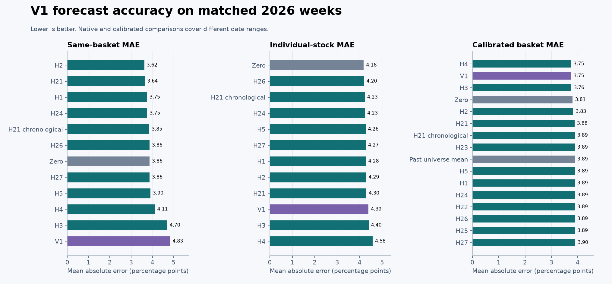
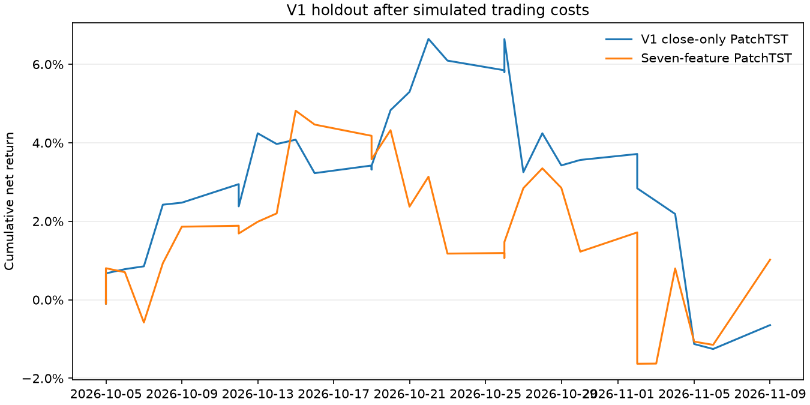
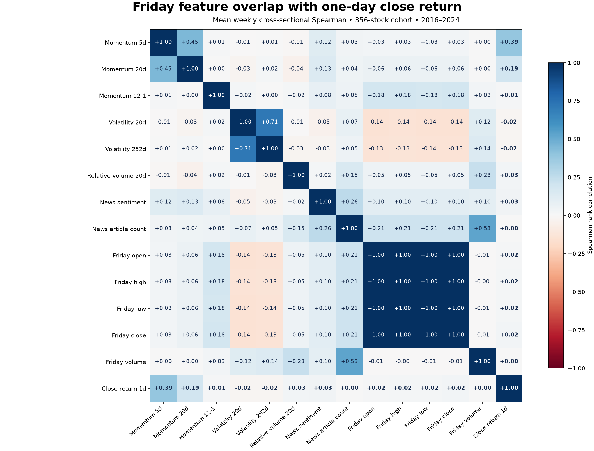
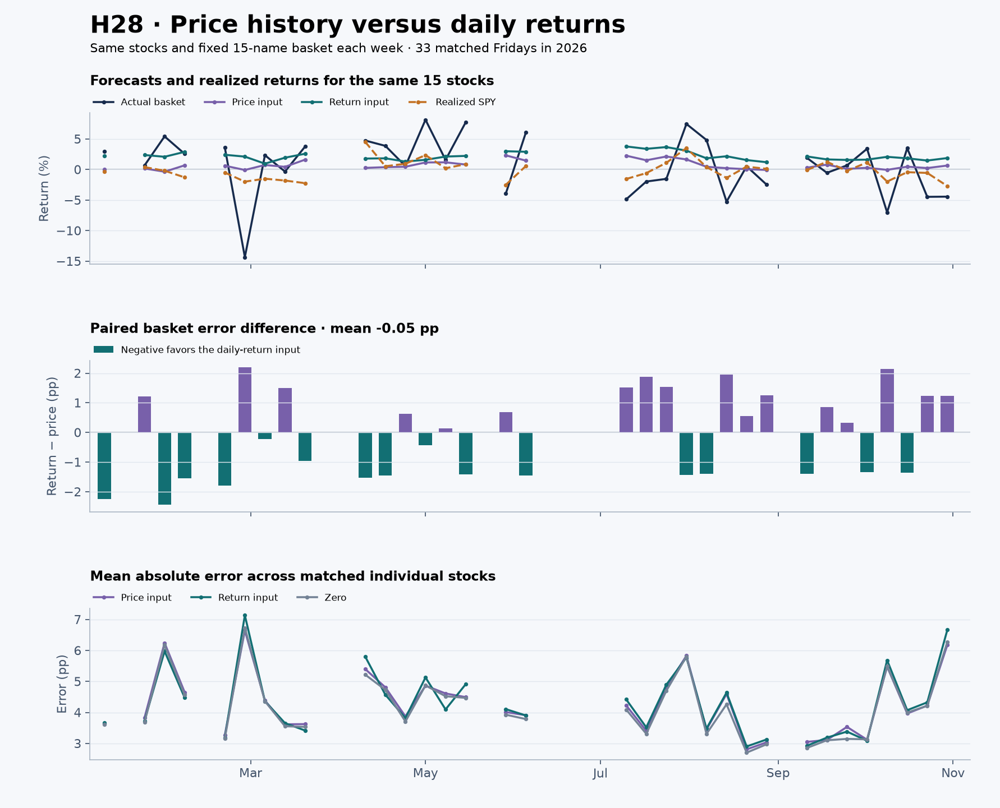
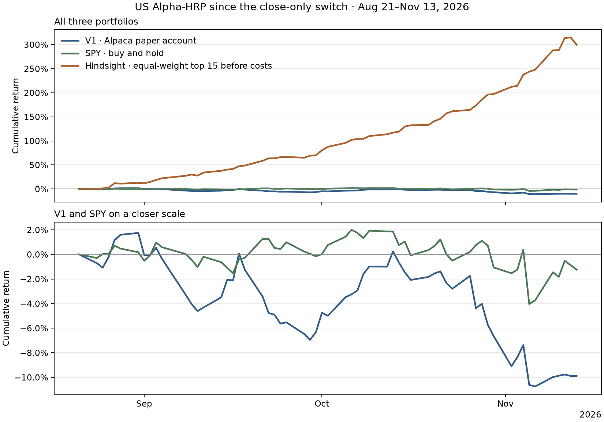
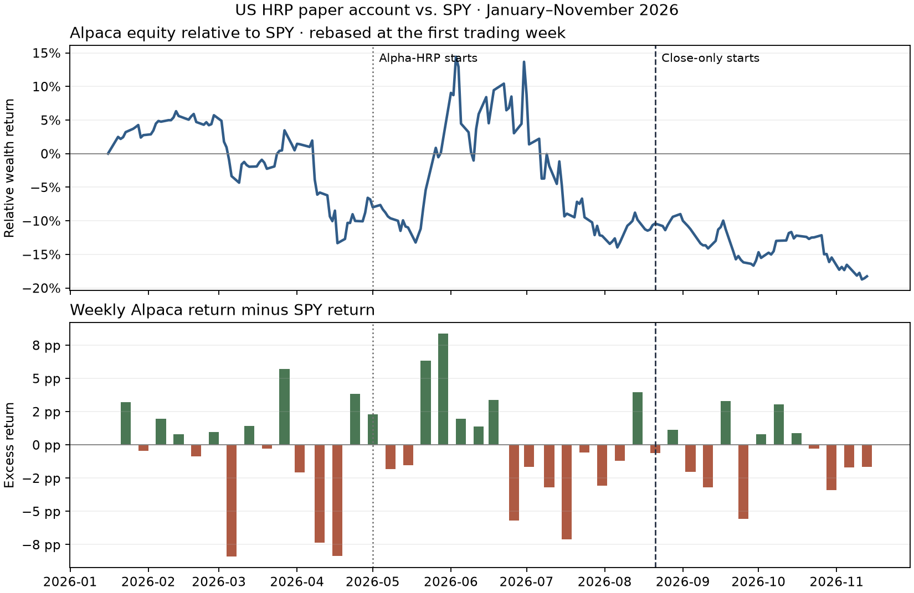
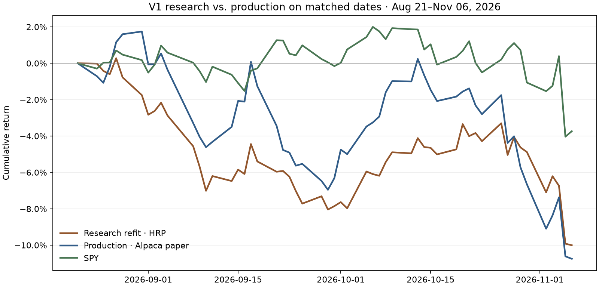

# AlphaAllocationV1

Improve the US Alpha-HRP V1 strategy before resuming [AlphaAllocationV2](../AlphaAllocationV2/README.md). The goal is to find a V1 candidate with a repeatable net return advantage over dividend-adjusted SPY and the incumbent, with acceptable drawdown and turnover. This folder holds offline research. Any production adoption is a separate task.

[Saved research recommendation](V1_RESEARCH_RECOMMENDATION.md) · [Agent instructions](AGENTS.md)

## Starting evidence

The Alpaca HRP paper account returned **−9.90%** versus **−1.24%** for SPY from the August 21 to November 13, 2026 closes. It beat SPY in 5 of 12 measured weeks. The August 24 rebalance first used close-only checkpoint `v2026-08-21-0af698826abd`.

The baseline labeled “V1” in the earlier hypothesis tables was a **research refit**, trained on 2021–2024 and selected on 2025 validation. On the overlapping August 21 to November 6 window, the refit with HRP returned **−10.01%**, the paper account **−10.75%**, and SPY **−3.74%**. Across six archived production reports, the replay and production selected an average of 6.67 of the same 15 names. The realized shortfall motivates the investigation. The before-and-after comparison leaves the effects of model design, training data, market conditions, and execution unresolved.

[Account and checkpoint comparison](#research-replay-versus-the-deployed-model) · [October production audit](alpha_hrp_audit_2026_10_03/AUDIT.md) · [Input timing correction](alpha_hrp_audit_2026_10_03/CORRECTION.md)

## Research sequence

1. **Reconcile deployed V1.** For several archived weeks, use the checkpoint, timestamped inputs, eligible universe, and prior holdings available at the decision. Compare scores, sticky selections, HRP weights, orders, fills, cash, and NAV with saved production evidence. Record discrepancies by stage and date. If a checkpoint or historical input is missing, report what can be verified from archived targets and fills, and label the rest as a reconstruction.
2. **Audit historical inputs.** Check when each symbol and observation became available. Use point-in-time membership where available. Disclose any frozen-roster approximation and its survivorship bias. Apply history, quality, and volatility exclusions using only data available at the relevant training or decision date. Distinguish verified zero news from missing coverage, and document delistings, corporate actions, session gaps, and excluded weeks.
3. **Run a compact walk-forward comparison.** Refit at the intended production cadence using completed labels. Keep training, checkpoint selection, and subsequent evaluation in chronological order. Use the same decision dates, eligible universe rules, `15/20` rank stickiness, 252-session HRP, execution conventions, and costs across candidates. Carry each candidate’s holdings and cash from its own simulated trades. Use a common evaluation universe where possible and report any differences in scoring coverage or eligibility. Prespecify seeds and report their spread.
4. **Confirm prospectively.** Use the earlier hypotheses and periods already inspected to choose a candidate and estimate plausible effect sizes. Freeze the candidate, incumbent comparison, SPY benchmark, and analysis before an untouched evaluation period or a prospective paper shadow run. Log each decision before the outcome is known. Base any production proposal on the confirmed results and the reconciliation evidence.

| Initial arm | Question |
| --- | --- |
| Close-only PatchTST with the production training recipe | What would a causally retrained incumbent have earned on the same weeks? |
| Close-only PatchTST with the research recipe | Does changing the training recipe improve results? |
| Seven-feature PatchTST with the research recipe | Do the seven channels improve results under that recipe? |
| Ridge with the same seven features | Does a simpler model deliver comparable portfolio results? |

Use the incumbent’s 60-session context and MSE on five daily close log returns for the PatchTST arms. Define the causal version of the research recipe, including its fit and validation windows, before running it. The exact deployed checkpoints are for historical reconciliation. The production-recipe arm is a separate walk-forward baseline. If the research recipe helps, isolate training-window length, validation design, and missing-session handling before attributing the improvement to any one change. Use the [V2 feature definitions](../AlphaAllocationV2/README.md#ridge-and-patchtst-on-matched-2025-fridays) to identify the seven channels. Align the target and input history with Ridge where practical and document any differences that prevent attributing the result to model choice alone.

## Statistical evaluation

Use matched weekly portfolio returns as the unit of analysis. Mark the strategy and SPY at the same times, include distributions consistently, and measure strategy returns after execution costs. The Friday-close prediction label can still be useful for ranking. Score actual strategy performance using orders placed after the decision cutoff and fills the strategy could have received. Report cumulative net return, maximum drawdown, turnover, costs, and the fraction of weeks ahead of SPY alongside the primary statistic.

For each matched week, calculate two differences in percentage points:

- **Market excess:** candidate net return minus SPY total return.
- **Incumbent improvement:** candidate net return minus incumbent net return.

For each comparison, test the one-sided null that the mean weekly difference is zero or negative. Resample blocks of consecutive weeks jointly across strategies and SPY to preserve pairing and account for serial dependence. Define the primary block length and sensitivity checks before looking at confirmatory outcomes. Report the estimated differences, confidence intervals, and p-values. Use **Holm correction at 5%** for the family of prespecified confirmatory comparisons. Stock rows and random seeds do not increase the number of observed market weeks. ANOVA may help answer a separate group comparison with suitable assumptions. Use the paired weekly tests for the portfolio question.

Before confirmation, agree on a minimum economically worthwhile improvement, drawdown and turnover tolerances, and an evaluation horizon informed by the variability of weekly differences. Evidence for promotion should support both positive SPY excess and improvement on the incumbent, with an effect large enough to matter and acceptable risk. If the evidence is too imprecise to meet the prespecified decision rule, report the result as inconclusive. Review performance across market periods, concentration in a few weeks or names, and sensitivity to costs before interpreting any apparent win.

## Archived V1 experiments

The [H1–H27 forecast accuracy report and chart gallery](V1_FORECAST_ACCURACY.md) compares the archived forecasts with realized stock and basket returns on the same five-session Friday pairs. It contains all 27 individual charts, realized SPY, and simple forecast baselines. Regenerate the analysis from the repository root with `PYTHONPATH=brain_api python scratch/AlphaAllocationV1/compare_v1_forecast_accuracy.py`.

Finished charts are saved in [figures/](figures/) alongside the reports. The regeneration commands write working outputs, raw broker exports, and model checkpoints under the local, gitignored `data/` directory. Copy finished figures into `figures/` when updating a report.



These earlier runs are exploratory. Their scripts use the shared dataset and feature helpers in [AlphaAllocationV2](../AlphaAllocationV2/README.md#historical-datasets). Saved V1 checkpoints, reports, and broker exports are under this folder's gitignored `data/` directory. Historical manifests retain their original run paths.

### V1 holdout with HRP and trading costs

See the [frozen protocol](V1_HOLDOUT_PROTOCOL.md) for the October 5 to November 9, 2026 comparison of the current 60-session close-only setup and the seven-feature challenger. Fit the models on the prior archive and save the checkpoints before scoring the holdout. Run these commands from the repository root with the PatchTST replay dependencies installed. The news command uses historical Alpaca credentials and the pinned local FinBERT cache.

```sh
PYTHONPATH=brain_api:scratch/AlphaAllocationV2 python scratch/AlphaAllocationV1/train_v1_holdout.py --device mps
PYTHONPATH=brain_api:scratch/AlphaAllocationV2 python scratch/AlphaAllocationV1/build_v1_holdout_data.py prices
PYTHONPATH=brain_api:scratch/AlphaAllocationV2 python scratch/AlphaAllocationV1/build_v1_holdout_data.py news
PYTHONPATH=brain_api:scratch/AlphaAllocationV2 python scratch/AlphaAllocationV1/run_v1_holdout.py
```

[Summary](data/v1_holdout/summary.json) · [Weekly returns and costs](data/v1_holdout/weekly_results.csv) · [Daily NAV](data/v1_holdout/nav.csv) · [HRP weights](data/v1_holdout/weights.csv) · [Simulated trades](data/v1_holdout/trades.csv)



### Five V1 hypotheses

The [protocol](V1_HYPOTHESES.md) compares the current specification with each single change, all three changes together, and seven features plus the smaller training universe with the 60-session context. It keeps the daily prediction target, loss, sticky selector, HRP and simulated cost model fixed. Each test uses a common inference universe within its pair. The tests use paired weekly net returns and Holm correction at 5%. The portfolio leaderboard uses the intersection of eligible stocks across all six models.

```sh
PYTHONPATH=brain_api:scratch/AlphaAllocationV2 python scratch/AlphaAllocationV1/build_v1_holdout_data.py news --news-start 2025-12-22 --news-end 2026-11-09
PYTHONPATH=brain_api:scratch/AlphaAllocationV2 python scratch/AlphaAllocationV1/train_v1_hypotheses.py --device mps
PYTHONPATH=brain_api:scratch/AlphaAllocationV2 python scratch/AlphaAllocationV1/run_v1_hypotheses.py
```

[Hypothesis results](data/v1_hypotheses/summary.json) · [Weekly net returns](data/v1_hypotheses/weekly_results.csv) · [Daily NAV](data/v1_hypotheses/nav.csv)

The January 12–November 9, 2026 replay had 40 paired holding periods. On the common set of 403–418 eligible names per decision, compounded net returns were +39.82% for the V1 reference, −10.21% for H1, −5.59% for H2, +17.08% for H3, +6.28% for H4, and +2.77% for H5. H3 was the strongest challenger by net return. H5 had the smallest drawdown at 14.74% and the highest 2025 validation rank correlation at +0.0340. All one-sided Holm-adjusted p-values were 1.00. The close-only research refit led this comparison. The fixed 2021–2024 fitting and 2025 validation dates are specific to the research replay. [Summary and pair-specific results](data/v1_hypotheses/summary.json)

Run `PYTHONPATH=brain_api:scratch/AlphaAllocationV2 python scratch/AlphaAllocationV1/run_v1_hypotheses.py --equal-weight` to replay the saved forecasts at 1/15 per holding. The replay carries NAV forward from $10,000 and applies the same costs. The pair-specific sticky picks match the HRP run. On the common candidate set, net returns were +46.13% for V1, −7.03% for H1, −6.65% for H2, +28.67% for H3, +12.51% for H4, and +3.30% for H5. All Holm-adjusted p-values for improvement over V1 were 1.00. [Equal-weight summary](data/v1_hypotheses/equal_weight/summary.json) · [Weekly results](data/v1_hypotheses/equal_weight/weekly_results.csv)

### Top-15 ranking and market hypotheses

Run `PYTHONPATH=brain_api:scratch/AlphaAllocationV2 python scratch/AlphaAllocationV1/compare_v1_rank_market.py` with the saved equal-weight replay and Yahoo's dividend-adjusted SPY opens in `data/v1_hypotheses/diagnostics/spy_adjusted_prices.csv`. H11–H15 test whether the sticky portfolio finds more of the realized top 15 per Friday than V1. Rank actual adjusted-close returns from Friday to the next trading Friday exactly seven days later, using the eligible candidate set common to each pair. The output includes strict and sticky hit counts, actual winners, and weekly Spearman correlations. The tests use 37 matched Fridays.

H16–H20 test whether each challenger earns positive weekly net excess return over SPY. Compare the net portfolio NAV returns with dividend-adjusted SPY open-to-open returns for the same 40 holding periods. SPUS is a secondary halal benchmark. Both ETFs use buy-and-hold returns before benchmark trading costs. Report the number of periods ahead and the mean excess in market-down periods. Use the existing four-observation circular bootstrap for one-sided p-values and Holm correction across all ten tests at 5%. [Summary](data/v1_hypotheses/diagnostics/summary.json) · [Actual top 15 and model hits](data/v1_hypotheses/diagnostics/ranking_weekly.csv) · [Weekly market comparison](data/v1_hypotheses/diagnostics/market_weekly.csv)

| Rank and market tests | Mean top-15 hits, challenger vs. V1 | Cumulative lead vs. SPY | Periods ahead of SPY | Mean excess when SPY fell |
|---|---:|---:|---:|---:|
| H11 / H16 · Seven features | 0.81 vs. 1.65 | −14.62 pp | 18/40 | −0.76 pp |
| H12 / H17 · One-year input | 1.51 vs. 1.70 | −16.00 pp | 23/40 | −2.70 pp |
| H13 / H18 · 356-stock training cohort | 1.84 vs. 1.70 | +33.33 pp | 25/40 | −0.56 pp |
| H14 / H19 · All three changes | 1.97 vs. 1.65 | +4.25 pp | 26/40 | −2.66 pp |
| H15 / H20 · Seven features and 356-stock training | 0.81 vs. 1.65 | −5.06 pp | 18/40 | −0.39 pp |

All ten Holm-adjusted p-values were 1.00. H3 was the strongest challenger by cumulative excess return. H4 found the most actual top-15 winners. V1 beat SPY by 42.51 percentage points in the H3 matched comparison. The V1 scores in this replay came from the close-only research refit.

### Weekly return, ranking, and SPY-relative losses

The [H21–H23 protocol](V1_LOSS_COMPARISON.md) keeps H5's inputs and compares five-session return MSE, within-week pairwise ranking, and a SPY-relative basket objective with a double shortfall penalty. It includes the run commands and the matched validation and evaluation design. [Summary](data/v1_hypotheses/loss_comparison/summary.json) · [Stock scores and actual ranks](data/v1_hypotheses/loss_comparison/stock_scores.csv) · [Basket forecasts](data/v1_hypotheses/loss_comparison/basket_forecasts.csv) · [Weekly portfolios and SPY](data/v1_hypotheses/loss_comparison/portfolio_weekly.csv)

H24 adds an IBKR fee penalty to H21's weekly MSE. It uses SAC's IBKR Singapore Tiered schedule and a $10,000 training NAV. Compare it with the saved H21 and a weekly-MSE control trained in the same chronological order. All portfolios in this replay use the same per-leg IBKR fees. [Protocol](V1_LOSS_COMPARISON.md#h24--weekly-mse-with-sacs-ibkr-fees) · [Results](data/v1_hypotheses/loss_comparison/h24_ibkr/summary.json)

H25 uses a single ranking score, the prior top-15 membership flag, and a pairwise loss with IBKR fees. It averaged 0.46 realized top-15 hits per Friday versus 1.65 for V1 and replaced 0.31 names per rebalance versus 4.31. V1 earned the higher net return under both weightings. [Protocol, results, and both portfolio charts](V1_H25_RANK_IBKR.md).

H26 and H27 supervise all seven forecast channels and use the close return to rank stocks. H26 predicts five daily steps and H27 predicts one Friday-to-Friday step. H27 earned +17.98% with equal weights and +12.56% with HRP, compared with +42.94% and +27.95% for V1. [Protocol, results, and portfolio chart](V1_MULTITARGET.md).

[H28](V1_H28_SENTIMENT.md) trains the seven-feature daily close forecaster on complete windows, then tests whether a one-day negative sentiment shock changes sticky selection.

The one-day return heatmap extends the original 2016–2024 Friday Spearman matrix. Adjusted close and the return since the previous session had mean rank correlation +0.024 across 456 Fridays. On 443 matched Fridays, rank correlations against realized next-Friday performance were +0.001 for adjusted close and −0.019 for the one-day return. [Estimates, intervals, and coverage](data/close_return_spearman/summary.json). Regenerate with `PYTHONPATH=brain_api:scratch/AlphaAllocationV2 python scratch/AlphaAllocationV1/compare_close_and_return_spearman.py`.



The [H28 close-input ablation](V1_H28_CLOSE_RETURN.md) compares the saved price-history model with a refit that replaces that input with daily adjusted-close log return. Both forecasts are compared with the same observed stock returns and fixed baskets.

On 33 matched Fridays, the return input reduced basket MAE from 3.80 to 3.75 pp (return minus price −0.05 pp, 95% interval −0.45 to +0.34, one-sided p = 0.402). It increased individual-stock MAE from 4.26 to 4.30 pp and basket RMSE from 4.74 to 5.04 pp. This single-seed replay supports keeping price as the H28 baseline. [Full metrics](data/v1_hypotheses/h28_close_return/summary.json) · [Weekly comparisons](data/v1_hypotheses/h28_close_return/forecast_weekly.csv)



### Actual V1 paper performance since the close-only switch

The one-input PatchTST migration landed August 23, 2026 in `4e91cd1`. The August 24 production rebalance first used checkpoint `v2026-08-21-0af698826abd`. Normalize the curves at the August 21 pre-switch close. Use Alpaca's reported HRP paper-account equity through November 13, with the regular-session 16:00 intraday mark for the final date while the daily series ends November 12. The activity export contains 751 fills across 216 orders, 21 fees, two dividends, and zero external cash transfers. [October production audit](alpha_hrp_audit_2026_10_03/AUDIT.md)

V1 fell 9.90% from $99,715.76 to $89,843.29. Dividend-adjusted SPY fell 1.24%. The hindsight reference earned 299.65% gross by buying the 15 future winners at equal weights each Friday and holding through the next Friday close. The benchmark uses Yahoo adjusted prices from the frozen August universe, with 426 candidates with complete prices each week. It assumes perfect foresight and zero trading costs. The snapshot is a proxy for the changing production roster. This period measures the account's realized paper performance following the switch. The October audit documents other model changes made at the same time.

Run `PYTHONPATH=brain_api:scratch/AlphaAllocationV2 python scratch/AlphaAllocationV1/fetch_v1_production_comparison.py` to read Alpaca and refresh adjusted prices through the latest completed US session, followed by `PYTHONPATH=brain_api:scratch/AlphaAllocationV2 python scratch/AlphaAllocationV1/plot_v1_production_comparison.py`. The raw Alpaca evidence and the fill export are stored in the ignored scratch data directory. [Weekly comparison](data/v1_production_comparison/weekly_comparison.csv) · [Hindsight picks](data/v1_production_comparison/hindsight_picks.csv)



#### Before and after the August 24 rebalance

Compare actual Alpaca equity with dividend-adjusted SPY from the January 16 close, before the first recorded fills on January 20. The initial $100,000 cash journal reconciles to that baseline. Alpaca returned no later external funding activity. The January–April account includes an older HRP strategy. The May 1 close precedes the first archived Alpha-HRP report on May 4. Use the last exchange close of each week and split at the August 21 close, before the first close-only trades.

| Period | Alpaca | SPY | Cumulative excess | Mean weekly excess | Weeks ahead | Ahead in SPY down weeks |
|---|---:|---:|---:|---:|---:|---:|
| Jan 16–Aug 21 · full HRP account | −0.28% | +11.30% | −11.58 pp | −0.28 pp | 14/31 | 7/13 |
| May 1–Aug 21 · Alpha-HRP before the switch | +3.72% | +6.53% | −2.80 pp | −0.07 pp | 6/16 | 1/5 |
| Aug 21–Nov 13 · close-only Alpha-HRP | −9.90% | −1.24% | −8.66 pp | −0.73 pp | 5/12 | 3/7 |

Before the switch, Alpha-HRP had a smaller average weekly shortfall. The close-only period had a slightly higher hit rate and a smaller mean shortfall in SPY down weeks. Both periods lagged SPY on average. Market conditions, checkpoints, and portfolio rules varied across the periods. The comparison describes account performance and cannot isolate the effect of dropping the four input channels.

Run `PYTHONPATH=brain_api:scratch/AlphaAllocationV2 python scratch/AlphaAllocationV1/compare_v1_switch.py` with the saved data, or add `--refresh-through 2026-11-13` to read the broker and benchmark again. [Weekly excess returns](data/v1_production_comparison/before_after_weekly.csv).



#### Research replay versus the deployed model

The V1 baseline in the hypothesis comparisons is a close-only research refit trained on 2021–2024 and selected on 2025 validation. The production checkpoint used at the August switch was `v2026-08-21-0af698826abd`. The January–November comparisons reuse a research window that starts before the August launch. They compare challenger specifications and provide no direct evidence of deployed V1's performance.

From the August 21 close through the November 6 close, the last daily close in the saved research NAV, the H25/H26/H27 V1 HRP refit lost 10.01%, Alpaca lost 10.75%, and SPY lost 3.74%. The refit had already gained 41.99% from its January start through August 21. Its equal-weight counterpart lost 13.49% on the matched window. The headline January–November gain is sensitive to the pre-launch portion.

The six archived production reports from August 24 through September 28 share an average of 6.67 names out of 15 with the research replay. Repricing each week's target weights at the same Friday closes gives a gross return of −1.75% for the deployed targets and −6.71% for the refit targets. Actual Alpaca NAV returned −5.00% in those six weeks. The remaining difference mixes execution timing, sizing, previous holdings, cash, and broker marks. The aggregate closeness of the matched NAV curves does not establish weekly trade parity. Use historical checkpoint versions and timestamped production inputs, targets, and fills for a production replication before using replay results to judge deployment.

Run `PYTHONPATH=brain_api:scratch/AlphaAllocationV2 python scratch/AlphaAllocationV1/reconcile_v1_replay.py` with the saved research and Alpaca exports. [Weekly target comparison](data/v1_production_comparison/matched_replay_targets.csv).


