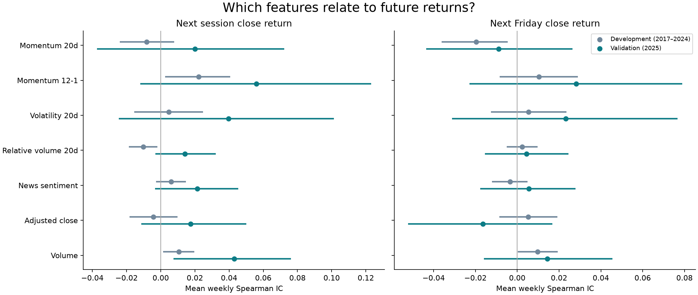
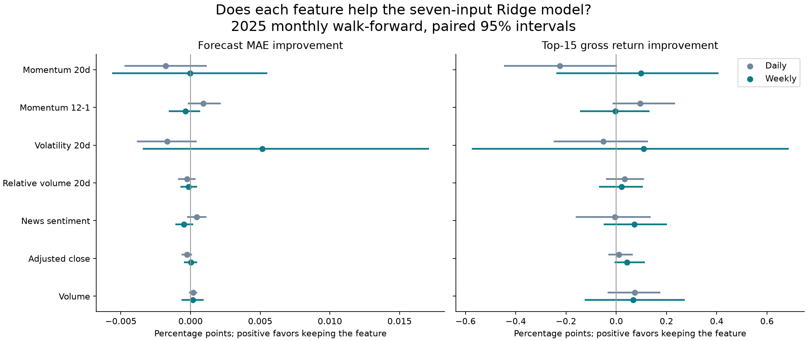
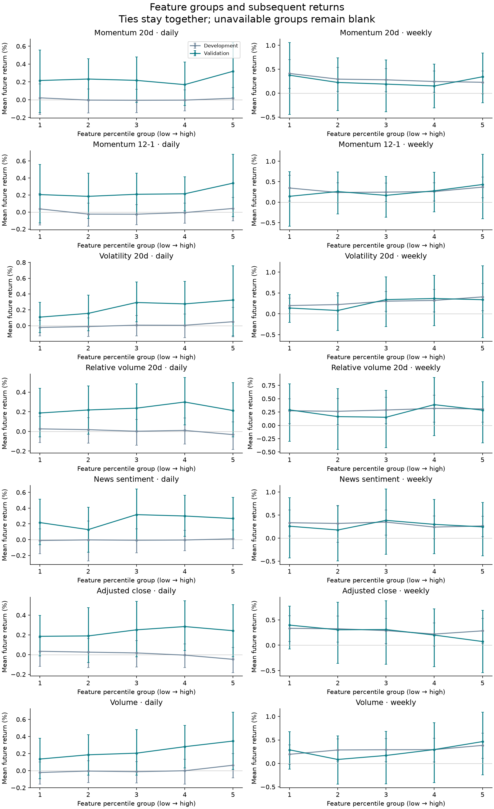
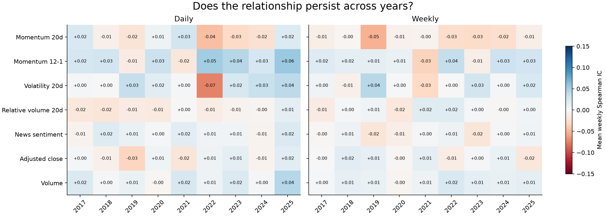

# Seven features versus future close returns

## Protocol recorded before this run

This exploratory analysis measures whether the seven candidate inputs relate to subsequent returns and add predictive value. Use the existing audited 356-stock Friday panel, including the ten volatile stocks retained in that panel. Today's frozen roster and the cohort selected using the beginning of the archive limit historical generalization. Earlier research used both 2016–2024 and 2025 when choosing these features. Results on these years remain exploratory.

Use development outcomes ending in 2016–2024 and historical validation outcomes ending in 2025. A feature is observed by Friday's exchange close. The daily outcome is the next exchange session's close divided by Friday's close, minus one. The weekly outcome is the following calendar Friday's close divided by Friday's close, minus one. Leave Friday holidays and unavailable endpoints missing for the weekly outcome. Preserve verified corporate-action adjustments and missing unresolved returns from the original audit. Verified empty news is zero sentiment. Unknown news remains missing.

Analyze the same complete seven-feature rows across features for comparability. Use the actual weekly calendar for resampling, including unavailable weeks as missing observations. Resample circular blocks of four calendar weeks, with 10,000 draws and seed 42. Repeat the key estimates with blocks of eight and thirteen weeks. Report point estimates and pointwise 95% percentile intervals. Calculate centered two-sided bootstrap p-values and apply Holm correction at 5% across all relationship tests in the primary four-week analysis. Confidence intervals alone do not account for selection or multiple comparisons.

For each feature, horizon, and period, calculate weekly cross-sectional Spearman information coefficients, their average, yearly averages, and future returns in five percentile-rank groups. Equal feature values stay together, so groups can be unequal or empty. Report the highest-minus-lowest group spread. Assess possible curved relationships with the second-difference contrast `Q1 - 2*Q3 + Q5`. The contrast compares each week's group returns, removing the common market return. Together the correlation, spread, and curvature tests assess different relationships. This approach accounts for dependence across stocks by treating each week as the observation and uses temporal blocks for inference.

For incremental value, fit fixed-penalty Ridge (`StandardScaler`, `alpha=1.0`) on the latest seven feature values to each outcome. Refit at the first available Friday of each month in 2025, using at most five years of training anchors and only labels ending strictly before the refit date. Compare all seven features with seven leave-one-feature-out models on identical training rows and scoring candidates. Include a training-mean prediction for forecast-error context. This tests a linear model with snapshot inputs. Sequence-model interactions require a separate experiment.

Report weekly stock MAE, rank IC, and the realized return of each model's strict equal-weight top 15. Select baskets before inspecting future labels, leave incomplete basket returns missing, and report their coverage. Define the incremental value as `reduced MAE - full MAE` for error and `full basket return - reduced basket return` for selection. Apply Holm across the 28 two-sided ablation tests covering seven features, two horizons, and these two metrics. Show differences in turnover and an illustrative 10-basis-point per-unit-traded-notional cost sensitivity for weekly-close baskets. Carry holdings and cash through that diagnostic. Friday-close entry uses the feature cutoff itself, and the archive has adjusted prices rather than historical raw execution prices. Treat those cost-adjusted values as hypothetical diagnostics, with executable order timing, IBKR minimum fees, HRP, and SPY confirmation reserved for the V1 replay protocol.

No economic effect threshold is inferred from these results. Preserve the full candidate list, all results, raw weekly series, forecasts, picks, exclusions, and source hashes. This run informs feature research. Promotion evidence requires the separate prospective V1 comparison.

## Method references

- [SciPy Spearman documentation](https://docs.scipy.org/doc/scipy/reference/generated/scipy.stats.spearmanr.html) describes the rank statistic and the limitations of its asymptotic p-value. This analysis estimates uncertainty from weekly blocks.
- [Scikit-learn time-series validation documentation](https://scikit-learn.org/stable/modules/generated/sklearn.model_selection.TimeSeriesSplit.html) describes chronological evaluation. This study splits on dates and label endpoints so stock rows from the same week remain together.

## Results

The archive contains 356 stocks and 180,136 rows. Complete seven-feature rows total 159,829. Inference uses 84 relationship tests in one Holm family and 28 ablation tests in a separate family. All reported intervals are pointwise and exploratory.

The 12–1 momentum warmup means the complete-feature analysis actually starts in 2017. Development covers 2017–2024. Validation covers 2025, with 50 next-session observations and 47 next-Friday observations per feature. These daily outcomes are sampled after Friday decisions. They cover the following exchange session, usually Monday.

None of the 84 relationship tests or 28 incremental-value tests passed the primary Holm-adjusted 5% threshold. All seven 2025 weekly IC intervals and all seven paired weekly basket-improvement intervals include zero. The evidence leaves each feature's contribution uncertain. Retain the list as research candidates and evaluate it against the incumbent in the causal V1 protocol before choosing a production change.

### Future-return rank relationships

| Feature | 2025 daily IC [95% CI] | daily Holm p | 2025 weekly IC [95% CI] | weekly Holm p |
| --- | --- | --- | --- | --- |
| Momentum 20d | +0.020 [-0.037, +0.072] | 1.000 | -0.009 [-0.044, +0.026] | 1.000 |
| Momentum 12-1 | +0.056 [-0.012, +0.123] | 1.000 | +0.028 [-0.023, +0.079] | 1.000 |
| Volatility 20d | +0.040 [-0.024, +0.101] | 1.000 | +0.023 [-0.031, +0.077] | 1.000 |
| Relative volume 20d | +0.014 [-0.003, +0.032] | 1.000 | +0.004 [-0.015, +0.025] | 1.000 |
| News sentiment | +0.021 [-0.003, +0.045] | 1.000 | +0.006 [-0.018, +0.028] | 1.000 |
| Adjusted close | +0.018 [-0.011, +0.050] | 1.000 | -0.017 [-0.052, +0.017] | 1.000 |
| Volume | +0.043 [+0.007, +0.076] | 1.000 | +0.014 [-0.016, +0.046] | 1.000 |

### Incremental value in weekly-return Ridge

Positive values favor keeping the feature. MAE and basket returns answer different questions. All models use the same candidate rows, with training-only scaling and completed-label purging.

| Feature | MAE improvement, pp [95% CI] | MAE Holm p | Top-15 gross improvement, pp [95% CI] | Basket Holm p |
| --- | --- | --- | --- | --- |
| Momentum 20d | -0.000 [-0.006, +0.006] | 1.000 | +0.099 [-0.239, +0.408] | 1.000 |
| Momentum 12-1 | -0.000 [-0.002, +0.001] | 1.000 | -0.003 [-0.144, +0.132] | 1.000 |
| Volatility 20d | +0.005 [-0.003, +0.017] | 1.000 | +0.108 [-0.575, +0.686] | 1.000 |
| Relative volume 20d | -0.000 [-0.001, +0.000] | 1.000 | +0.021 [-0.068, +0.106] | 1.000 |
| News sentiment | -0.000 [-0.001, +0.000] | 1.000 | +0.072 [-0.049, +0.201] | 1.000 |
| Adjusted close | +0.000 [-0.000, +0.000] | 1.000 | +0.043 [-0.006, +0.114] | 1.000 |
| Volume | +0.000 [-0.001, +0.001] | 1.000 | +0.067 [-0.126, +0.273] | 1.000 |

### Forecast context

| Outcome | Seven-feature stock MAE, pp | Training-mean stock MAE, pp | Seven-feature rank IC |
| --- | --- | --- | --- |
| daily | 1.4684 | 1.4660 | +0.0019 |
| weekly | 3.3412 | 3.3456 | +0.0212 |

These MAEs are averages of weekly stock MAEs on the same scored observations. The training-mean predictor provides a simple forecast reference.

### Proportional-cost sensitivity

| Feature | Paired weeks | 10-bp diagnostic improvement, pp | Turnover difference, full minus reduced |
| --- | --- | --- | --- |
| Momentum 20d | 36 | +0.096 | +0.027 |
| Momentum 12-1 | 43 | -0.003 | -0.001 |
| Volatility 20d | 44 | +0.136 | -0.279 |
| Relative volume 20d | 44 | +0.020 | +0.012 |
| News sentiment | 44 | +0.068 | +0.035 |
| Adjusted close | 44 | +0.041 | +0.017 |
| Volume | 43 | +0.071 | -0.040 |

This table pairs the complete observations for each comparison. It applies 10 bp per unit of traded notional to hypothetical Friday-close rebalances and tracks weight drift between decisions. It provides a descriptive sensitivity check under those assumptions.

### Nonlinear patterns and temporal stability

The percentile-group chart displays each feature's shape. The low-versus-high spread and the `Q1 - 2*Q3 + Q5` curvature contrast are dependence-aware comparisons of group means. Empty groups caused by tied values stay missing. Tests with fewer than twelve observations have no inferential conclusion.

### Multiplicity-adjusted relationships

No relationship test passed Holm at 5%.

### Coverage

| period | horizon | metric | minimum weeks | maximum weeks |
| --- | --- | --- | --- | --- |
| development | daily | curvature | 339 | 405 |
| development | daily | ic | 405 | 405 |
| development | daily | spread | 405 | 405 |
| development | weekly | curvature | 331 | 393 |
| development | weekly | ic | 393 | 393 |
| development | weekly | spread | 393 | 393 |
| validation | daily | curvature | 42 | 50 |
| validation | daily | ic | 50 | 50 |
| validation | daily | spread | 50 | 50 |
| validation | weekly | curvature | 39 | 47 |
| validation | weekly | ic | 47 | 47 |
| validation | weekly | spread | 47 | 47 |

### Reproducibility and limits

Run from the repository root with `PYTHONPATH=brain_api:scratch/AlphaAllocationV2 python scratch/AlphaAllocationV1/analyze_feature_relationships.py`. Install pandas, numpy, scipy, scikit-learn, duckdb, exchange-calendars, matplotlib, requests, and pyarrow. The [manifest and model metrics](data/feature_relationships/summary.json) record source hashes, environment versions, code revision, coverage, fit boundaries, and the analysis settings. The [relationship estimates](data/feature_relationships/relationship_estimates.csv) and [ablation estimates](data/feature_relationships/ablation_estimates.csv) include 4-, 8-, and 13-week blocks. [Weekly observations](data/feature_relationships/relationships_weekly.csv), [group returns](data/feature_relationships/groups_weekly.csv), [stock forecasts](data/feature_relationships/stock_forecasts.parquet), [basket picks](data/feature_relationships/picks.csv), [folds](data/feature_relationships/folds.csv), [omitted basket outcomes](data/feature_relationships/missing_basket_outcomes.csv), and [cost sensitivity](data/feature_relationships/close_cost_diagnostic.csv) support independent review.

The cohort and feature choices reflect historical exploration. The daily label shares the original price evidence but has only the archived large-daily-move and action masks, while weekly labels also use the weekly audit. Friday-close basket entry and flat proportional costs are diagnostic assumptions. The cost diagnostic flags incomplete price marks and records a reset at the next usable decision. It excludes IBKR order minima, executable timing, HRP, and a matched SPY portfolio comparison. Candidate removal, deployment, and claims of SPY outperformance require the V1 validation protocol.
