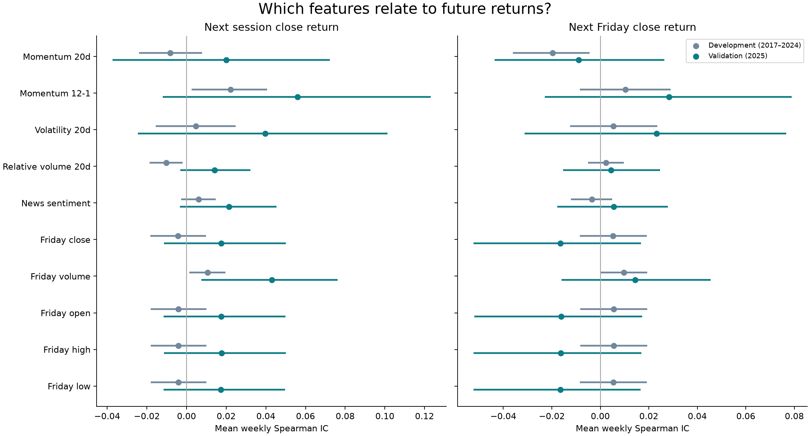
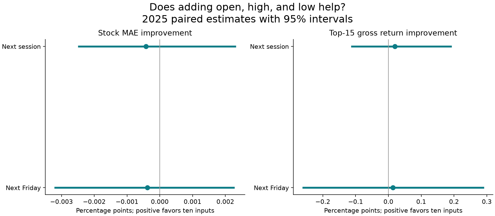
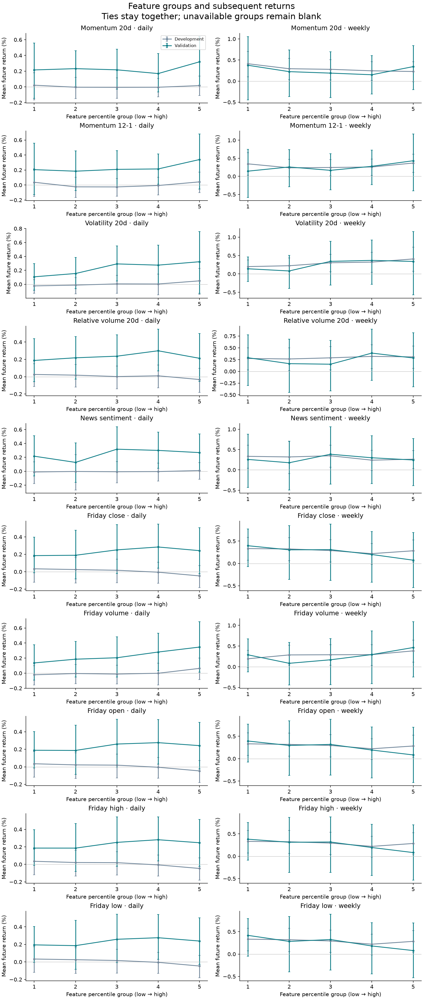
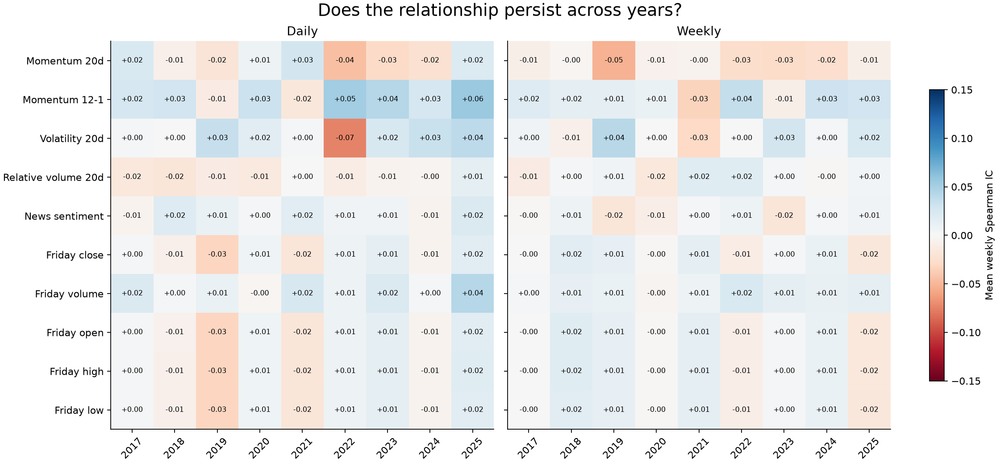
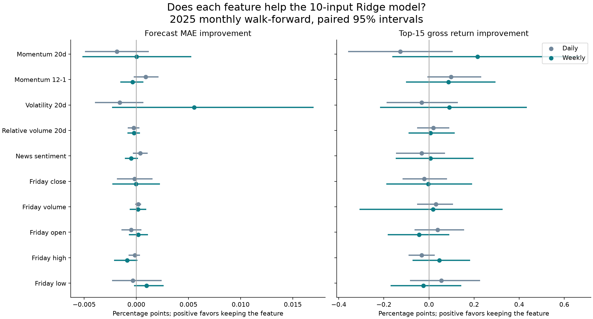

# OHLCV and the seven features versus future returns

## Protocol recorded before this run

Extend the [seven-feature study](V1_FEATURE_RELATIONSHIPS.md) with Friday open, high, and low. Adjusted close and volume already belong to the seven-feature set, giving ten distinct inputs. Reuse the 356-stock archived cohort, audited return labels, news availability, and chronological evaluation. Use the complete ten-feature rows for every arm. Reject nonpositive or internally inconsistent OHLC bars based on the bar at the decision, and record exclusions.

Use the same daily outcome from Friday close to the next exchange-session close and the same weekly outcome from Friday close to the following calendar Friday close. Development covers available complete-feature observations in 2017–2024. The 2025 comparison remains exploratory because prior experiments used these years. Resample calendar weeks in four-week circular blocks with 10,000 draws and seed 42, with eight- and thirteen-week sensitivity checks. Report pointwise 95% intervals and centered two-sided p-values. Apply Holm at 5% across 120 relationship tests covering ten features, two horizons, two periods, and three metrics (Spearman IC, highest-minus-lowest group return, and curvature). Inspect the correlation between the new OHLC prices and adjusted close for redundancy.

Fit monthly fixed-penalty Ridge models with training-only StandardScaler and `alpha=1.0`, using at most five years of anchors with label endpoints strictly before each refit. Compare all ten inputs against the original seven as a bundle and against ten leave-one-feature-out arms. Use identical rows and candidates across models. Apply Holm across 44 paired tests covering eleven comparisons, two horizons, and stock MAE or top-15 gross return. Report rank IC descriptively. Select each strict equal-weight top 15 before checking labels, preserve missing basket outcomes, and report matched coverage. Report the original seven-versus-ten results on common weeks for each metric. Cost sensitivity uses the existing hypothetical 10-bp proportional-cost diagnostic with drifting weights.

The raw OHLC channels describe nominal prices at Friday's close. This study evaluates their incremental value for snapshot Ridge. Forecast relationships, historical selection, and the proportional-cost diagnostic leave sequence-model performance and executable V1 returns to the separate V1 protocol. Preserve all outcomes and scripts.

## Results

There are **ten distinct features**, since close and volume were already included in the original seven. The comparison covers 356 archived stocks and 159,829 complete stock-Friday rows, with 0 inconsistent OHLC rows excluded at the feature cutoff.

At the prespecified four-week block length, 0 of 120 relationship tests and 0 of 44 incremental-value tests pass Holm at 5%. Inspect the effects and intervals below when judging practical value. All results remain exploratory.

### Conclusion

Adding open, high, and low changes mean weekly gross basket return by +0.0139 pp, with a 95% interval of [-0.2620, +0.2916] pp. This interval leaves the direction of the incremental return uncertain. Raw OHLC levels carry strongly overlapping cross-sectional information. A feature set for deployment must earn its place through the executable V1 comparison with the incumbent and SPY.

### Individual feature relationships

| Feature | 2025 daily IC [95% CI] | daily Holm p | 2025 weekly IC [95% CI] | weekly Holm p |
| --- | --- | --- | --- | --- |
| Momentum 20d | +0.020 [-0.037, +0.072] | 1.000 | -0.009 [-0.044, +0.026] | 1.000 |
| Momentum 12-1 | +0.056 [-0.012, +0.123] | 1.000 | +0.028 [-0.023, +0.079] | 1.000 |
| Volatility 20d | +0.040 [-0.024, +0.101] | 1.000 | +0.023 [-0.031, +0.077] | 1.000 |
| Relative volume 20d | +0.014 [-0.003, +0.032] | 1.000 | +0.004 [-0.015, +0.025] | 1.000 |
| News sentiment | +0.021 [-0.003, +0.045] | 1.000 | +0.006 [-0.018, +0.028] | 1.000 |
| Friday close | +0.018 [-0.011, +0.050] | 1.000 | -0.017 [-0.052, +0.017] | 1.000 |
| Friday volume | +0.043 [+0.007, +0.076] | 1.000 | +0.014 [-0.016, +0.046] | 1.000 |
| Friday open | +0.017 [-0.012, +0.050] | 1.000 | -0.016 [-0.052, +0.017] | 1.000 |
| Friday high | +0.018 [-0.011, +0.050] | 1.000 | -0.016 [-0.052, +0.017] | 1.000 |
| Friday low | +0.017 [-0.012, +0.050] | 1.000 | -0.017 [-0.052, +0.017] | 1.000 |

### Seven versus ten inputs on matched weeks

| Horizon | Metric | Matched weeks | Seven (pp except IC) | Ten (pp except IC) | Ten minus seven |
| --- | --- | --- | --- | --- | --- |
| daily | mae | 50 | 1.4684 | 1.4688 | +0.0004 pp |
| daily | ic | 50 | 0.0019 | 0.0013 | -0.0007 IC |
| daily | basket_return | 50 | 0.2786 | 0.2981 | +0.0195 pp |
| weekly | mae | 47 | 3.3412 | 3.3415 | +0.0004 pp |
| weekly | ic | 47 | 0.0212 | 0.0247 | +0.0035 IC |
| weekly | basket_return | 44 | 0.5589 | 0.5728 | +0.0139 pp |
| weekly | net_10bp_diagnostic | 44 | 0.4821 | 0.4854 | +0.0032 pp |

MAE is lower when forecasts are more accurate. Rank IC and basket return increase when the scored ordering performs better. Gross and cost-adjusted basket means use the intersection of complete baskets for the two models.

| Horizon | Metric | Weeks | Improvement from adding OHL, pp [95% CI] | Holm p |
| --- | --- | --- | --- | --- |
| daily | mae | 50 | -0.0004 [-0.0025, +0.0023] | 1.0000 |
| daily | basket_return | 50 | +0.0195 [-0.1139, +0.1932] | 1.0000 |
| weekly | mae | 47 | -0.0004 [-0.0032, +0.0023] | 1.0000 |
| weekly | basket_return | 44 | +0.0139 [-0.2620, +0.2916] | 1.0000 |

Positive improvement favors ten inputs. For MAE this is `seven MAE - ten MAE`. For basket return it is `ten return - seven return`.

### OHLC price overlap

| left | right | mean_weekly_spearman | weeks |
| --- | --- | --- | --- |
| open | close | 0.99984 | 50 |
| high | close | 0.999911 | 50 |
| low | close | 0.99991 | 50 |

These are contemporaneous feature-to-feature correlations. Strong overlap limits the distinct information in raw nominal OHLC levels. The seven-versus-ten bundle comparison tests their combined incremental value.

### Chart gallery

### Reproducibility and limitations

Run `PYTHONPATH=brain_api:scratch/AlphaAllocationV2 python scratch/AlphaAllocationV1/analyze_ohlcv_relationships.py` from the repository root. The [manifest](data/feature_relationships_ohlcv/summary.json) records source and code hashes, environment versions, common-row coverage, and the protocol hash. [Relationship estimates](data/feature_relationships_ohlcv/relationship_estimates.csv), [incremental-value estimates](data/feature_relationships_ohlcv/ablation_estimates.csv), and [paired seven-versus-ten metrics](data/feature_relationships_ohlcv/seven_vs_ten.csv) contain the numeric results. The data directory also stores forecasts, monthly folds, standardized coefficients, selected stocks, weekly observations, group means, and omitted basket outcomes.

Historical feature selection and the frozen roster limit generalization. Daily means the next exchange session after Friday. Snapshot Ridge measures linear predictive value, while PatchTST uses a sequence. The Friday-close basket returns and the 10-bp cost sensitivity assume hypothetical entry at the feature cutoff and omit IBKR order minima and realistic execution. This experiment informs candidate selection. Executable V1 performance versus SPY requires the separate V1 protocol.
