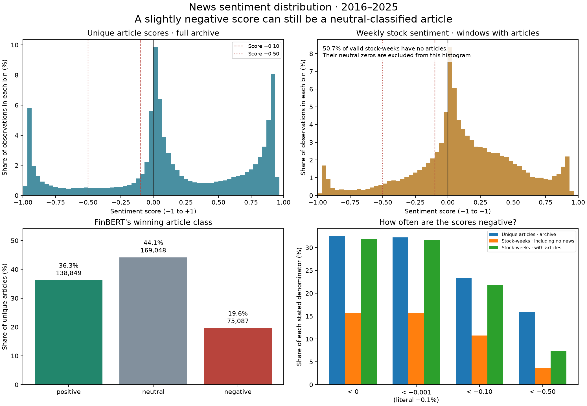
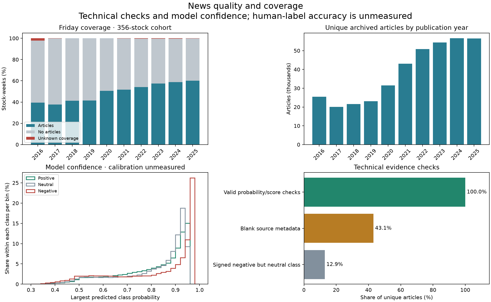
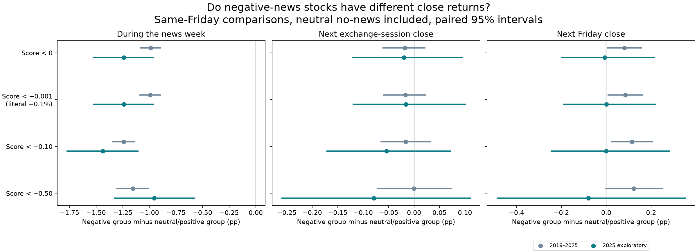

# News distribution, quality checks, and subsequent close returns

## Protocol recorded before the conditional-return analysis

Analyze the local 2016–2025 Alpaca/Benzinga archive and the existing audited 356-stock Friday panel. Report article distributions using unique provider article IDs after retaining the latest stored version available by the archive end. Report stock-week distributions separately for valid Friday news windows, both including verified no-news windows as neutral zero and conditioning on windows with articles. Unknown coverage remains missing. The article inventory and the Friday panel have different units and coverage. State every denominator.

The score is `P(positive) - P(negative)` on the interval [-1, 1]. Count strict scores below 0, below -0.001 (the literal -0.1%), below -0.10, and below -0.50. FinBERT's negative winning class is a separate classification based on the largest class probability. Show the fraction of negative signed scores classified as neutral. Check probability ranges and sums, score consistency, confidence consistency, source metadata, revision counts, coverage statuses, and neutral zero-news handling. These are technical evidence checks. Human labeling and calibration accuracy are unmeasured.

For return analysis, use the archived, cutoff-safe weekly sentiment available at Friday's close. Include price-usable stock-Friday rows with known news, independently of the other six features. The forward outcomes are next-session close return and next-calendar-Friday close return. Leave audited invalid prices and Friday holidays missing. Also describe returns during the news week, obtained from the preceding audited Friday return, to distinguish contemporaneous association from subsequent prediction. The contemporaneous comparison cannot identify whether news preceded the price movement.

For each negative threshold, compare mean stock returns within a Friday with the same-Friday nonnegative-score group, including verified no-news zero scores as neutral. Retain a group difference only when both groups have at least five observed stock returns. Also show the nonnegative group with articles and the no-news group separately for context. Average the weekly differences equally across dates, preserving missing calendar Fridays in the bootstrap. Report group counts, paired dates, mean returns, confidence intervals, and the fraction of group returns below zero. Classify these comparisons as observational associations, with sector, company characteristics, and news-selection effects unresolved.

Use four-week circular block bootstraps with 10,000 draws and seed 42, plus eight- and thirteen-week sensitivity checks. Estimate the full 2016–2025 period, 2016–2024 development, and already-explored 2025 validation separately. Keep label endpoints inside each period. Apply Holm at 5% to the 24 forward-return comparisons covering four thresholds, two horizons, and three periods. Report pointwise 95% percentile intervals. Contemporaneous and alternative-control estimates remain descriptive. Specify no threshold as an economically proven trading rule. Preserve scripts, figures, weekly observations, source hashes, and all outcomes.

## Results

The inventory contains 382,984 unique articles across 420 stocks with articles, from 2016-01-04T14:00:54+00:00 through 2025-12-29T13:59:57+00:00. It has 562,201 latest article-stock mappings. The return analysis uses the existing 356-stock cohort, with 179,365 price-usable rows with known sentiment.

The pinned news archive has coverage records for 428 requested securities. Those with coverage but no article records are FDXF, HLAL, HSHCY, NCLTY, SMERY, SPUS, UMMA, VGNT. Verified no-news observations remain usable neutral inputs.

### Interpretation

At a weekly score below −0.10, the negative-news group differs from neutral/positive stocks by -1.240 pp during the news week. Its subsequent weekly difference in the 2025 comparison is -0.0004 pp, with a 95% interval of [-0.2475, +0.2824] pp. This describes a strong contemporaneous association and uncertain subsequent predictive value. Price changes can generate news, and unmeasured company characteristics can affect both sentiment and returns.

### Score units and the meaning of negative

A sentiment score is a probability difference, `P(positive) - P(negative)`. The literal −0.1% threshold is −0.001. The −0.10 score threshold is also displayed to make the unit ambiguity explicit. Thresholds are nested, so their percentages should be read separately.

| Denominator | Observations | Score < 0 | Score < −0.001 (−0.1%) | Score < −0.10 | Score < −0.50 |
| --- | --- | --- | --- | --- | --- |
| Unique articles · archive | 382,984 | 124,590 (32.53%) | 123,578 (32.27%) | 89,078 (23.26%) | 61,170 (15.97%) |
| Unique articles · 356-stock cohort | 358,212 | 117,618 (32.83%) | 116,665 (32.57%) | 84,253 (23.52%) | 58,063 (16.21%) |
| Stock-weeks · including no news | 179,492 | 28,221 (15.72%) | 28,055 (15.63%) | 19,271 (10.74%) | 6,443 (3.59%) |
| Stock-weeks · with articles | 88,578 | 28,221 (31.86%) | 28,055 (31.67%) | 19,271 (21.76%) | 6,443 (7.27%) |

| Winning FinBERT class | Unique articles | Share |
| --- | --- | --- |
| positive | 138,849 | 36.25% |
| neutral | 169,048 | 44.14% |
| negative | 75,087 | 19.61% |

Among the 124,590 unique articles with a negative signed score, 49,503 (39.73%) have neutral as FinBERT's most probable class. A small imbalance between negative and positive probabilities can coexist with a much larger neutral probability. The archive contains 47,715 articles with a winning negative probability of at least 0.80.

### Technical quality and coverage

| Check | Count |
| --- | --- |
| unique articles checked | 382984 |
| valid records | 382984 |
| invalid probability range | 0 |
| invalid probability sum | 0 |
| invalid score formula | 0 |
| invalid confidence formula | 0 |
| invalid text hash | 0 |
| blank source | 164992 |
| probability ties | 0 |
| negative score but neutral class | 49503 |
| negative signed score | 124590 |
| negative winning class | 75087 |
| negative winning class probability at least 0 8 | 47715 |

| Friday news status | Stock-weeks |
| --- | --- |
| verified_empty | 90914 |
| complete | 88578 |
| missing_window | 356 |
| missing_revision | 288 |

Probability arithmetic checks and source metadata describe technical quality. Blank source metadata is recorded as missing. The model's confidence is its largest predicted class probability. Human sentiment accuracy, probability calibration, and company-specific article relevance remain unmeasured. The inventory uses the latest stored article revision before archive end. The return analysis uses the original Friday aggregates, with revisions available only after the cutoff excluded or marked unknown.

### Does negative sentiment relate to subsequent close returns?

The comparison is between negative-score stocks and the same-Friday nonnegative group, which includes verified no-news zero scores. Results average matched weeks equally. A week needs at least five observed stock returns in each group. The historical archive gives associations. Causal effects of news remain unresolved.

#### Following Friday close, 2016–2025

| News condition | Weeks | Negative stock-weeks | Negative group return, % | Neutral/positive return, % | Difference, pp [95% CI] | Holm p |
| --- | --- | --- | --- | --- | --- | --- |
| Score < 0 | 490 | 27409 | +0.382 | +0.300 | +0.081 [+0.004, +0.158] | 0.716 |
| Score < −0.001 (−0.1%) | 490 | 27246 | +0.385 | +0.300 | +0.085 [+0.006, +0.162] | 0.632 |
| Score < −0.10 | 490 | 18718 | +0.415 | +0.300 | +0.115 [+0.021, +0.209] | 0.370 |
| Score < −0.50 | 462 | 6172 | +0.425 | +0.302 | +0.123 [-0.007, +0.252] | 1.000 |

#### Next exchange-session close, 2016–2025

| News condition | Weeks | Negative stock-weeks | Negative group return, % | Neutral/positive return, % | Difference, pp [95% CI] | Holm p |
| --- | --- | --- | --- | --- | --- | --- |
| Score < 0 | 505 | 28219 | +0.030 | +0.049 | -0.018 [-0.062, +0.023] | 1.000 |
| Score < −0.001 (−0.1%) | 505 | 28053 | +0.032 | +0.049 | -0.017 [-0.061, +0.024] | 1.000 |
| Score < −0.10 | 505 | 19269 | +0.032 | +0.049 | -0.016 [-0.066, +0.034] | 1.000 |
| Score < −0.50 | 476 | 6340 | +0.061 | +0.061 | -0.001 [-0.073, +0.074] | 1.000 |

#### Following Friday close, 2025 exploratory validation

| News condition | Weeks | Negative stock-weeks | Negative group return, % | Neutral/positive return, % | Difference, pp [95% CI] | Holm p |
| --- | --- | --- | --- | --- | --- | --- |
| Score < 0 | 47 | 2564 | +0.246 | +0.253 | -0.007 [-0.201, +0.217] | 1.000 |
| Score < −0.001 (−0.1%) | 47 | 2546 | +0.254 | +0.253 | +0.001 [-0.193, +0.224] | 1.000 |
| Score < −0.10 | 47 | 1567 | +0.253 | +0.253 | -0.000 [-0.248, +0.282] | 1.000 |
| Score < −0.50 | 45 | 428 | +0.286 | +0.365 | -0.079 [-0.489, +0.354] | 1.000 |

There are 0 Holm-adjusted results below 5% among the 24 forward-return comparisons in the prespecified family. Pointwise intervals and effect sizes remain the primary description of uncertainty.

The first panel compares returns during the week from which the news was collected. News can react to price changes within that window. The other panels compare outcomes after the Friday cutoff and are the relevant prediction diagnostics. Sector, size, volatility, and provider coverage differences can affect these associations. An unconditional sentiment correlation can conceal a conditional tail relationship, so the threshold results are reported independently.

### Reproducibility

Run `PYTHONPATH=brain_api:scratch/AlphaAllocationV2 python scratch/AlphaAllocationV1/analyze_news_sentiment.py` from the repository root. The [summary](data/news_sentiment/summary.json) records source/code hashes, score units, denominators, quality checks, coverage, and versions. The [distribution counts](data/news_sentiment/distribution_counts.csv), [weekly group observations](data/news_sentiment/conditional_weekly_returns.csv), and [conditional estimates](data/news_sentiment/conditional_estimates.csv) preserve the numeric results. Alternative controls, loss frequencies, minimum-group exclusions, and 4-, 8-, and 13-week blocks are retained in those files. The [article inventory](data/news_sentiment/articles.parquet) contains identifiers and scoring metadata without article text. No trading rule or production change is selected by this exploratory analysis.
