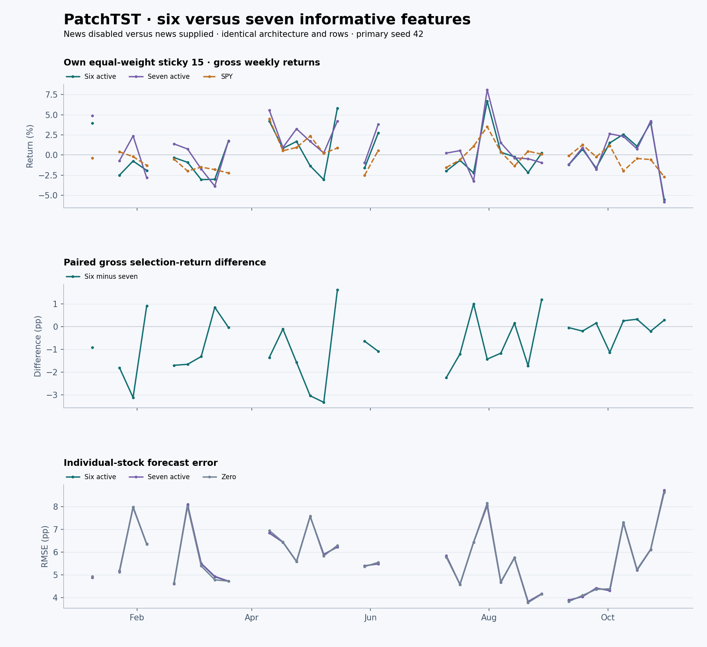

# PatchTST with six versus seven informative features

## Protocol

Compare the research PatchTST from the [matched XGBoost experiment](V1_XGBOOST_COMPARISON.md) against the same recipe with news sentiment disabled. Keep seven network input slots and replace the normalized sentiment history with constant zero during training, validation, and inference. Six slots carry feature information in the ablation. This holds parameter count, initial weights, and random-number consumption at initialization equal within each seed.

The six retained features are 20-day momentum, 12–1 momentum, 20-day volatility, 20-day relative volume, adjusted-close price, and reported volume. Preserve the existing per-window normalization in both arms. The separate preprocessing concern identified during review is outside this ablation.

Reuse the immutable normalized arrays and row keys under `data/xgboost_comparison/`. Both arms use the identical 82,399 training examples from 2021–2024 and 20,938 validation examples from 2025. Preserve news-based eligibility in the six-feature arm so any difference comes from the supplied information. Test predictions cover all 40 original decision Fridays, and the matched outcome comparison uses the same 33 five-session Friday-to-Friday periods in 2026 and 13,712 observed stock outcomes.

Keep the one-year histories, weekly simple-return output, MSE training, target scaling, batch size 256, Adam learning rate 0.0003, gradient clipping 1, 60-epoch cap, patience eight, validation-MSE checkpoint selection, and 15/20 sticky selection. Use the original seven-feature checkpoints for seeds 42, 43, and 44. Fit a new six-informative-feature counterpart for each seed. Seed 42 is primary and the other seeds measure training sensitivity.

## Outcomes and statistics

Primary outcome is the paired weekly gross return difference of independently selected equal-weight 15-stock baskets, six minus seven, on common observed weeks. SPY subtraction cancels in this paired comparison. Test the two-sided null of zero mean difference with four-observed-week circular block resampling, 20,000 draws and seed 42. Report the point estimate, 95% interval, and p-value at the 5% level. Use two- and eight-week block sensitivity. This is one predefined primary comparison. Additional seeds and SPY-relative intervals are descriptive.

Report gross weekly returns and excess over SPY, weeks ahead of SPY, forecast MSE/MAE/R², rank correlation, same-fixed-basket forecast error, selected names, and overlap between the two selections. Fixed-basket errors reuse the original V1-refit selections from the matched comparison. Preserve the original gross Friday-close research convention. Costs, HRP weights, and broker execution do not enter the quoted result.

The evaluation period has informed previous experiments. The historical frozen roster introduces survivorship bias. These outcomes remain exploratory. Save new checkpoints and tables under `data/patchtst_news_ablation/`, leaving the seven-feature artifacts intact. Archive charts under `figures/patchtst_news_ablation/` and embed them below.

## Results

| Arm | Paired weeks | Mean return (%) | Mean excess over SPY (pp) | Weeks ahead of SPY | Excess CI low (pp) | Excess CI high (pp) |
| --- | --- | --- | --- | --- | --- | --- |
| Six active | 33 | 0.1266 | 0.2299 | 16 | -0.3954 | 0.9282 |
| Seven active | 33 | 0.8596 | 0.9628 | 21 | 0.3394 | 1.5512 |

The primary six-minus-seven mean weekly return difference was -0.7330 pp (95% block interval -1.1201 to -0.3638 pp, two-sided p = 0.0003). The comparison used 33 paired observed weeks.

| Arm | Stock RMSE (pp) | Stock MAE (pp) | Stock R² | Mean rank IC | Fixed-basket MAE (pp) |
| --- | --- | --- | --- | --- | --- |
| Six active | 5.87197 | 4.1828 | -0.00134 | 0.02328 | 3.81703 |
| Seven active | 5.87321 | 4.18352 | -0.00177 | 0.02446 | 3.8024 |
| Zero | 5.86908 | 4.18084 | -0.00035 | — | 3.86299 |

The two primary selections shared an average of 8.78 names out of 15 across all 40 decision Fridays. Mean replacements after the first decision were 6.13 for six and 7.08 for seven.



### Seed sensitivity

| Arm | Paired weeks | Mean return (%) | Mean excess over SPY (pp) | Weeks ahead of SPY | Excess CI low (pp) | Excess CI high (pp) |
| --- | --- | --- | --- | --- | --- | --- |
| Six active | 33 | 0.1266 | 0.2299 | 16 | -0.3954 | 0.9282 |
| Seven active | 33 | 0.8596 | 0.9628 | 21 | 0.3394 | 1.5512 |
| Six active seed 43 | 33 | 0.3093 | 0.4126 | 16 | -0.5496 | 1.4715 |
| Seven active seed 43 | 33 | 0.4347 | 0.538 | 19 | -0.3188 | 1.4711 |
| Six active seed 44 | 33 | 0.3279 | 0.4312 | 19 | -0.3167 | 1.0323 |
| Seven active seed 44 | 33 | 0.3093 | 0.4126 | 18 | -0.2747 | 1.1043 |

| seed | paired_weeks | mean_six_minus_seven_pp | ci95_low_pp | ci95_high_pp | two_sided_p |
| --- | --- | --- | --- | --- | --- |
| 42 | 33 | -0.73295 | -1.12005 | -0.36384 | 0.0003 |
| 43 | 33 | -0.12544 | -0.77088 | 0.56204 | 0.72936 |
| 44 | 33 | 0.0186 | -0.59455 | 0.73838 | 0.89806 |

Only seed 42 is primary. The same historical outcomes have informed earlier experiments. The six-feature description means six informative inputs and a constant-zero sentiment slot, with the original seven-slot network retained. These results use gross adjusted-close returns.

[Weekly comparisons](data/patchtst_news_ablation/weekly_forecasts.csv) · [Stock forecasts and actuals](data/patchtst_news_ablation/stock_forecasts.parquet) · [Primary test and block sensitivity](data/patchtst_news_ablation/paired_tests.csv) · [Selection overlap](data/patchtst_news_ablation/overlap.csv) · [Source manifest](data/patchtst_news_ablation/manifest.json) · [Summary](data/patchtst_news_ablation/summary.json)

### Run commands

```sh
export PYTHONPATH=brain_api:scratch/AlphaAllocationV2
python scratch/AlphaAllocationV1/train_patchtst_news_ablation.py --device mps
python scratch/AlphaAllocationV1/report_patchtst_news_ablation.py
```
