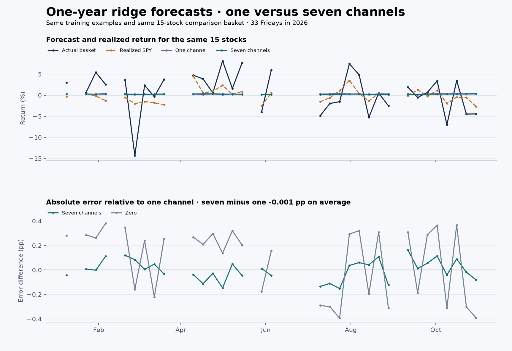

# Ridge regression with one year of inputs

Compare two pooled ridge regressions on the one-year question from H2 and H4. Fit both on the same historical stock-week examples so the training roster does not confound the result.

| Model | Input at each decision |
| --- | --- |
| One-channel ridge | Daily adjusted-close log returns in the trailing 365 calendar days |
| Seven-channel ridge | The archived seven daily channels over the same days: 20-day momentum, 12–1 momentum, 20-day volatility, 20-day relative volume, trailing news sentiment, adjusted-close price, and reported volume |

Use the H2/H4 window builder and common seven-feature eligibility for both arms, with the 255-position right-aligned windows. Require all adjusted-close log returns, the latest value of each feature, and at least 80% coverage per feature over the trading sessions in the window. Verified no-news windows have neutral sentiment. Normalize each feature history within its observed window and set masked positions to normalized zero. Flatten the window so ridge can learn a separate linear coefficient at each lag. Both arms predict the same five-session simple return directly.

Fit on stock-weeks with labels that finish by the end of 2024. Choose each ridge penalty by mean weekly stock MAE on 2025 validation. Both arms preferred the largest penalty in the initial grid (`0.0001` through `10`), so extend the grid through `10,000` to check stronger shrinkage. Selection uses only 2025 validation errors. Use the frozen broader research roster for both fits. Reuse the 33 exact five-session Friday pairs, stock labels, and fixed equal-weight 15-name baskets from the [forecast accuracy archive](V1_FORECAST_ACCURACY.md).

The primary metric is absolute return error on the same 15 names, averaged over Fridays. Report the seven-minus-one difference in percentage points, a 95% circular block-bootstrap interval, and a one-sided p-value for improvement (four adjacent observed weeks, 20,000 draws, seed 42). Report all-stock MAE and rank correlation, compare with a zero forecast, and show realized SPY for context. The seven-channel recipe uses adjusted-close price where the one-channel recipe uses a daily return. The comparison measures the two recipes as a whole. The frozen historical roster introduces survivorship bias, and the evaluation dates have informed earlier experiments, so treat this as exploratory.

## Results

Both models fit on 82,399 stock-weeks from 413 stocks and used 20,938 validation stock-weeks. The evaluation covers 13,712 observed stock returns and 33 matched Fridays from January 9 through October 30, 2026. The 2025 validation selected penalties of 10 for one channel and 100 for seven.

| Forecast | 15-stock basket MAE (pp) | Individual-stock MAE (pp) | Mean weekly Spearman |
| --- | ---: | ---: | ---: |
| One channel | 3.783 | 4.190 | −0.0222 |
| Seven channels | 3.781 | 4.184 | +0.0056 |
| Zero return | 3.863 | 4.181 | — |

Seven channels reduced mean basket MAE by 0.0013 percentage points, with lower error on 16 of 33 weeks. The paired difference (seven minus one) was −0.0013 pp, with a 95% interval of −0.037 to +0.034 pp and a one-sided p-value of 0.470. The two feature sets performed similarly on the primary outcome.

Seven channels reduced individual-stock MAE by 0.0059 pp (exploratory 95% interval −0.0103 to −0.0013), and forecasting zero gave the lowest individual-stock MAE. Both ridge forecasts stayed close to zero, and both average rank correlations were close to zero. This comparison gives little reason to prefer the seven-channel recipe for forecasting these baskets.



[Run manifest and validation grid](data/ridge_lookback/summary.json) · [Weekly basket forecasts](data/ridge_lookback/weekly_forecasts.csv) · [Stock forecasts and actual returns](data/ridge_lookback/stock_forecasts.parquet)

## Reproduce

Run from the repository root with the PatchTST scratch dependencies and a DuckDB version that can read the archived news files. The experiment used Python 3.12.16, DuckDB 2.0.0, NumPy 1.26.4, pandas 2.3.3, and SciPy 1.16.3.

```sh
PYTHONPATH=brain_api:scratch/AlphaAllocationV2 OPENBLAS_NUM_THREADS=4 \
  VECLIB_MAXIMUM_THREADS=4 python scratch/AlphaAllocationV1/compare_ridge_lookback.py
```
