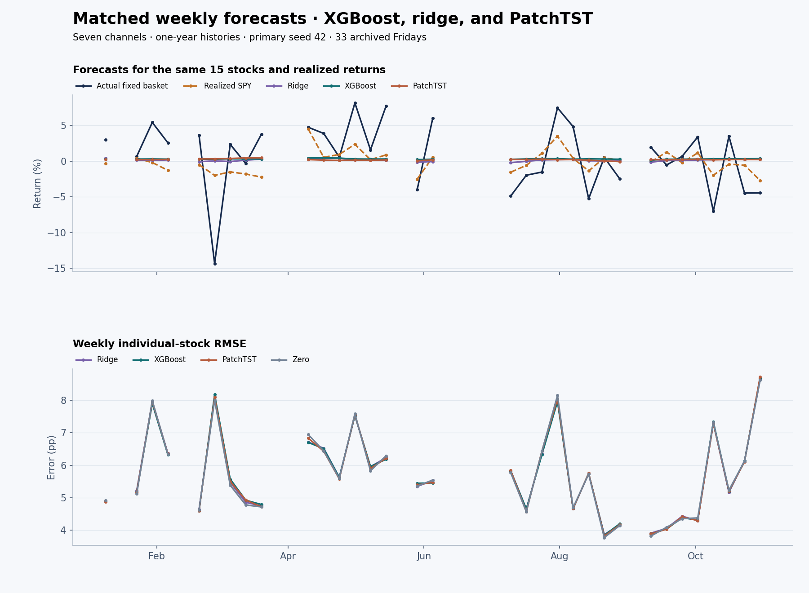
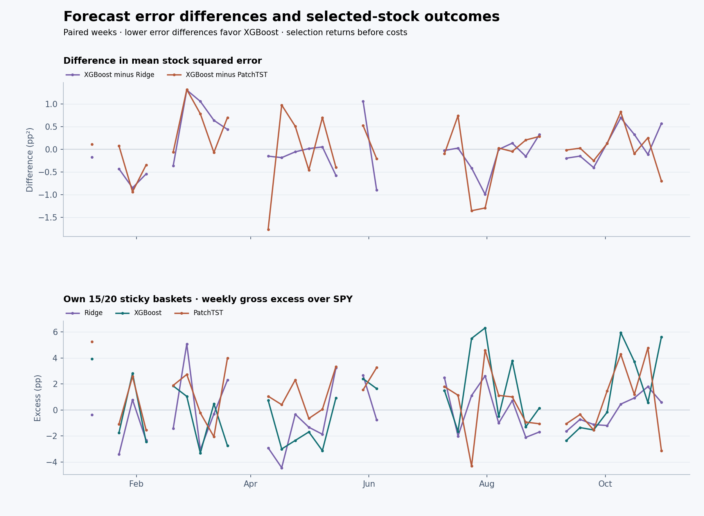

# XGBoost, ridge, and PatchTST on matched weekly forecasts

## Frozen experiment design

Compare the three algorithms using the archived seven feature histories over the trailing 365 calendar days, right-aligned in 255 session positions. Reuse the [ridge window construction](V1_RIDGE_LOOKBACK.md). Normalize each feature within its observed history and put masked entries at normalized zero. Ridge and XGBoost flatten the same 255 × 7 values supplied to PatchTST. The auxiliary eighth close-return channel in the archive is excluded from predictors.

Use identical eligible examples from the broad frozen August 2026 roster. Training decision dates run from January 8, 2021 through December 20, 2024, with the last target ending December 30, 2024. Validation decisions run from January 3 through December 19, 2025, with the last target ending December 29, 2025. The counts are 82,399 training and 20,938 validation examples. Predict the direct five-session simple return with squared-error loss. Training weights are equal per stock-week. Select hyperparameters and checkpoints using average weekly stock MSE on validation.

This is a controlled historical experiment on the already studied 33 Friday-to-Friday intervals in 2026, with decisions from January 9 through October 30 and 13,712 observed stock returns. Score intervals with exactly five trading sessions and preserve sticky selection across all 40 decision Fridays. Holiday intervals with fewer sessions are omitted from the matched forecast metrics. Historical roster membership introduces survivorship bias. Retain the source price exclusions and verified-neutral versus missing-news treatment. This evaluation period has informed earlier experiments.

## Models

- Ridge uses the existing nine average-MSE penalties from 0.0001 to 10,000. Select by validation MSE. Save all validation scores.
- XGBoost uses squared-error regression, histogram trees, depths 2 and 4, learning rate 0.03, 600-tree cap, minimum child weight 20, lambda 10, row/column subsampling 0.8, 128 histogram bins, four CPU threads, and 30-round validation early stopping. Select depth on seed 42 validation only. Repeat that depth with seeds 43 and 44.
- PatchTST uses the production geometry of 10-session patches and five-session stride, hidden width 64, two layers, four attention heads, and FFN width 128. Its regression head emits one weekly target. Disable internal scaling because all algorithms receive the same normalized histories. Use Adam at 0.0003, batch size 256, gradient clipping 1, a 60-epoch cap, validation-MSE checkpointing, and patience eight. Run seeds 42, 43, and 44. Scale targets by training standard deviation during optimization and restore return units for scoring.

Seed 42 is the predefined primary neural/tree forecast. Report other seeds as sensitivity checks. Preserve all checkpoints and histories. Existing H4 and ridge-MAE results remain historical references because their fitting or selection procedures differ from this experiment.

## Evaluation

Primary outcome is weekly mean individual-stock MSE. Pair XGBoost minus ridge and XGBoost minus matched PatchTST on the same observed outcomes. Test the one-sided null of no reduction using 20,000 circular bootstrap draws of four adjacent observed weeks, seed 42. Apply Holm adjustment across these two tests at 5%. Show two- and eight-week block sensitivity. Seeds do not increase the number of observed market weeks.

Also report stock MAE/RMSE/R² and rank correlation, fixed-15 basket error, zero and training-mean forecasts, and descriptive SPY regressions. Retain all 33 dates for the primary comparison. Choose each model's own 15/20 sticky basket from forecasts across every decision Friday before joining observed outcomes. Own-selection Friday-close returns and SPY differences are secondary gross diagnostics. Missing realized holdings remain missing, with common-week coverage stated. These diagnostics use adjusted closes before execution costs.

Archive finished charts in `figures/xgboost_comparison/`, embed them here, and keep arrays, models, source manifests, predictions, and statistical tables in the ignored `data/xgboost_comparison/` directory.

[XGBoost API](https://xgboost.readthedocs.io/en/stable/python/python_api.html#xgboost.XGBRegressor) · [PatchTST regression](https://huggingface.co/docs/transformers/model_doc/patchtst#transformers.PatchTSTForRegression)

## Results

| Model | Stock MSE (pp²) | Stock RMSE (pp) | Stock MAE (pp) | Stock R² | Mean rank IC | Fixed-basket MAE (pp) |
| --- | --- | --- | --- | --- | --- | --- |
| Ridge | 34.4937 | 5.8731 | 4.1928 | -0.0017 | -0.0029 | 3.7915 |
| XGBoost | 34.4965 | 5.8734 | 4.1893 | -0.0018 | -0.0004 | 3.7742 |
| PatchTST | 34.4946 | 5.8732 | 4.1835 | -0.0018 | 0.0245 | 3.8024 |
| Zero | 34.4461 | 5.8691 | 4.1808 | -0.0003 | — | 3.863 |
| Training mean | 34.4653 | 5.8707 | 4.1855 | -0.0009 | — | 3.7847 |

Stock MSE and MAE give each observed week equal weight. Stock R² pools the 13,712 observed stock returns. Primary XGBoost and PatchTST forecasts use seed 42.

| XGBoost versus | MSE difference (pp²) | 95% low | 95% high | Holm p |
| --- | --- | --- | --- | --- |
| Ridge | 0.0028 | -0.1949 | 0.2249 | 1 |
| PatchTST | 0.0019 | -0.1964 | 0.2036 | 1 |

Negative MSE differences favor XGBoost. The intervals and Holm p-values use the two predefined primary comparisons.



### Seed sensitivity

| Model | Stock MSE (pp²) | Stock RMSE (pp) | Stock MAE (pp) | Stock R² | Mean rank IC | Fixed-basket MAE (pp) |
| --- | --- | --- | --- | --- | --- | --- |
| xgboost_43 | 34.4637 | 5.8706 | 4.1858 | -0.0009 | 0.0055 | 3.7822 |
| xgboost_44 | 34.5735 | 5.8799 | 4.195 | -0.0041 | -0.0076 | 3.7845 |
| patchtst_43 | 34.5424 | 5.8773 | 4.1928 | -0.0032 | 0.0157 | 3.7531 |
| patchtst_44 | 34.488 | 5.8726 | 4.1824 | -0.0016 | 0.0115 | 3.8406 |

### Own selections and SPY

| Model | Weeks | Mean weekly return (%) | Mean excess over SPY (pp) | Weeks ahead | 95% excess low (pp) | 95% excess high (pp) |
| --- | --- | --- | --- | --- | --- | --- |
| Ridge | 33 | -0.3868 | -0.2835 | 13 | -0.9768 | 0.4097 |
| XGBoost | 33 | 0.4921 | 0.5954 | 18 | -0.5978 | 1.8035 |
| PatchTST | 33 | 0.8596 | 0.9628 | 21 | 0.3394 | 1.5512 |

Selections use the full common forecast universe before future return availability is examined. The table pairs all three strategies on weeks with all 15 selected outcomes observed. These are gross Friday-close diagnostics on sampled weeks. Execution costs and tradable portfolio NAV are outside this forecast comparison. Selection intervals use the same four-observed-week block bootstrap and are descriptive secondary intervals.

### Descriptive SPY regression

| Series | Market R² | Adjusted R² | SPY beta |
| --- | --- | --- | --- |
| Ridge | 0.04142 | 0.0105 | 0.02028 |
| XGBoost | 0.11083 | 0.08215 | 0.01214 |
| PatchTST | 0.07269 | 0.04278 | -0.01751 |
| Actual fixed basket | 0.35309 | 0.33222 | 1.76649 |

Each row fits the basket forecast or actual return against realized SPY with an intercept on the same 33 dates. Adjusted R² uses one SPY slope. This describes co-movement within these observations.



[Metrics](data/xgboost_comparison/metrics.csv) · [Weekly forecasts](data/xgboost_comparison/weekly_forecasts.csv) · [Stock forecasts and actuals](data/xgboost_comparison/stock_forecasts.parquet) · [Statistical tests and block sensitivity](data/xgboost_comparison/paired_tests.csv) · [Manifest and selected fits](data/xgboost_comparison/summary.json)

### Run commands

```sh
export PYTHONPATH=brain_api:scratch/AlphaAllocationV2
python scratch/AlphaAllocationV1/train_v1_xgboost_comparison.py --stage all --device mps
python scratch/AlphaAllocationV1/report_v1_xgboost_comparison.py
```
