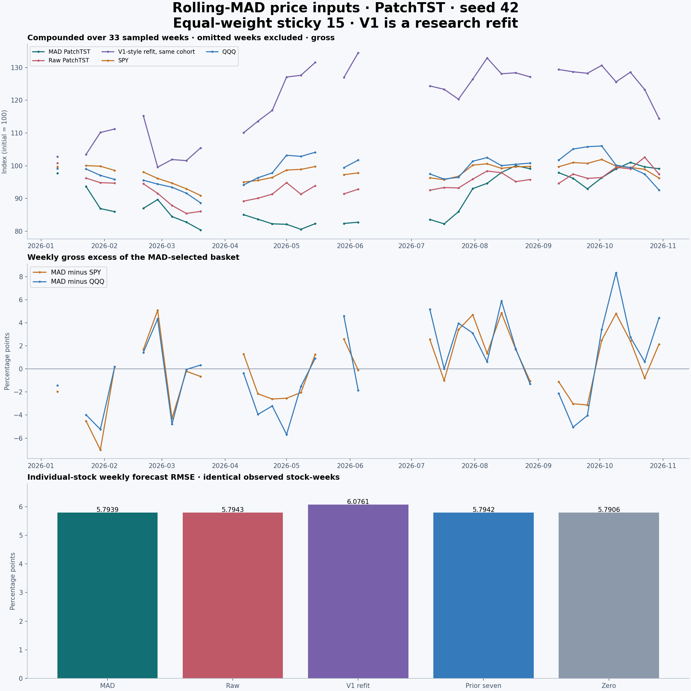
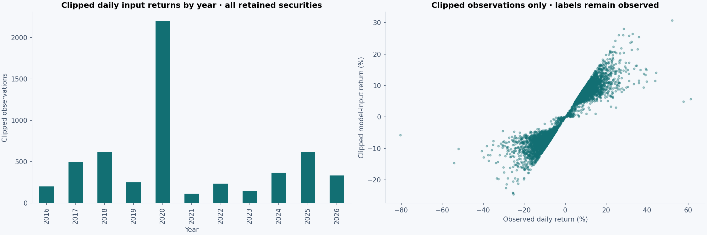
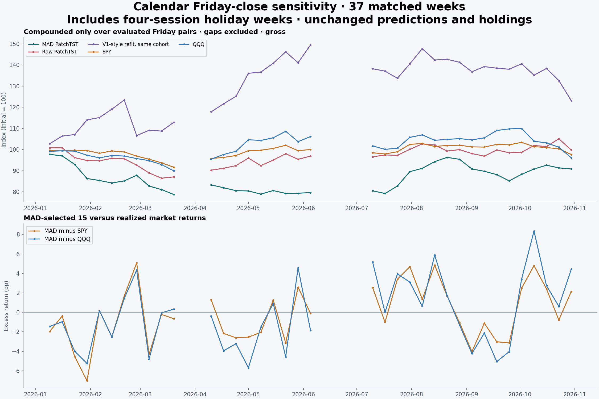

# Rolling-MAD price inputs and listing-age screening

## Frozen question and short-run design

Test whether causal rolling-MAD price-input clipping improves a seven-feature PatchTST screen. Train two matched seed-42 models: an unchanged-price control and the MAD challenger. Use the same retained universe, stock-week rows, 365-calendar-day input context padded to 255 sessions, weekly simple-return MSE, optimizer, validation-MSE checkpoint policy, and 15/20 rank-band sticky equal-weight selection. Both models predict one five-session simple return. This is a short exploratory historical experiment, not a production rollout or a seed-robustness study.

Start with the frozen 428-security roster used in the earlier research. Price history exists for 425. The archive identifies 54 series starting after its first 2016 session; these are not 54 independently certified company IPOs. Exclude later-starting series as a conservative listing-age proxy, except Legrand's LGRDY ADR, whose depositary documents show a 2014 effective date. Separately exclude the 13 verified foreign-to-US ticker identity collisions ABX, AI, AMS, CFR, CNR, CSL, DOL, ENR, OR, RKT, SAN, UCB, and WES, and the three symbols with no archived prices. Do not silently substitute different securities or news. This leaves 364 candidate securities: 48 later-series exclusions, 13 identity exclusions, and three missing-price exclusions. This operational cohort is not an independently verified IPO-date database. Other historical identity issues may remain.

The cutoff applies to the traded security series, including spin-offs, ADR programs, relistings, and ETF inception, rather than the founding date or original foreign company's IPO. Preserve all retained tickers regardless of volatility. Per-window missingness checks still apply, so 364 is a roster count, not the number eligible every Friday. Training uses 2021–2024, validation uses 2025, and testing uses the archived 2026 decisions through October 30. Preserve the original exact-five-session Friday-to-Friday outcome sample; holiday-shortened weeks are omitted from scored returns, while sticky state carries through all 40 decision Fridays. Targets must end before their fold boundary. This sample and the frozen current roster have previously been inspected and introduce historical reuse and survivorship bias.

## Transformation and interpretation

For each stock and session, let r be its observed adjusted-close log return. Estimate m = median(r) and MAD = median(abs(r − m)) over the **preceding 252 exchange sessions**, excluding the current session. Require 60 finite prior observations. Clip the current input return to m ± 6 × 1.4826 × MAD. Leave missing returns, insufficient-history rows, and zero-MAD windows unchanged; do not impute labels or missing prices. Compute each threshold causally from prior raw observations, including during validation and testing. The fixed rule is not tuned on outcomes.

Reconstruct a model-only close path by accumulating clipped-minus-observed log-return corrections. Recompute 20-session momentum, 12–1 momentum, and 20-session annualized volatility from the clipped input returns. These four price-derived channels change together. Preserve 20-session relative volume, reported volume, and sentiment exactly. Keep the previous per-window normalization. Preserve raw observed returns as labels and portfolio returns. Clipping can suppress genuine market information; a flagged move is not evidence of an erroneous quote. Price inputs are not the only possible data-quality problem, as the ticker audit demonstrates.

The [NIST MAD definition](https://www.itl.nist.gov/div898/software/dataplot/refman2/auxillar/mad.htm) supplies the robust scale convention; the causal window, warmup, and six-scale cap are this experiment's fixed choices. LGRDY's pre-cutoff existence is supported by [BNY's ADR record](https://www.adrbny.com/directory/dr-details/_jcr_content/root/drDetailsComponent.overview.overview.524671104.html). Depositary effective dates vary across banks; they are not interchangeable with a company's original IPO date.

## Comparisons and statistics

Compare gross equal-weight selected-15 returns with the raw-price matched control, SPY, QQQ, the archived 60-session close-only V1-style research refit, and the prior broad-universe seven-feature weekly research model. The V1 reference is a causal research refit, not actual deployed production weights or account performance. The broad-universe references preserve their original selections and may contain roster identity problems; report them transparently as frozen historical references. Also report common-stock forecast RMSE, MAE, rank correlation, and turnover.

Predefine four primary return contrasts: MAD minus raw control, V1-style refit, SPY, and QQQ. Test zero mean difference two-sided using 20,000 circular observed-week block resamples (block four, seed 42), report 95% intervals, and apply Holm across the four comparisons at family alpha 5%. Show two- and eight-week block sensitivity. The prior seven-feature candidate is descriptive. Weeks are the inferential units, not individual stocks. These are exploratory p-values on a reused period. Portfolio returns are gross adjusted-close research marks, before fees, slippage, and HRP; sampled-week compounded curves are not continuously executable NAV.

Keep prices, source hashes, exclusions, clipping audit, model inputs, checkpoints, training histories, predictions, selections, benchmark evidence, and results in ignored `data/rolling_mad/`. Archive charts under `figures/rolling_mad/` and link this report from the README. Do not change production data, model pointers, trading accounts, or schedules.

## Run commands

```sh
export PYTHONPATH=brain_api:scratch/AlphaAllocationV2:scratch/AlphaAllocationV1
python scratch/AlphaAllocationV2/mad_experiment_data.py
python scratch/AlphaAllocationV2/train_mad_patchtst.py --device mps
python scratch/AlphaAllocationV2/report_mad_patchtst.py
```

## Results

The paired comparison used 33 observed weeks and 11,915 common stock outcomes. Selections carried through all 40 decision Fridays. Additional incomplete-basket omissions: none.

The retained roster has 364 securities. Per-window eligibility produced 74,199 training examples across 363 stocks, 18,379 validation examples across 362 stocks, and 14,444 test forecasts across 363 stocks. Each arm used the identical rows.

| Model | Weeks | Mean weekly return (%) | Excess SPY (pp) | Excess QQQ (pp) | Weeks above SPY | Weeks above QQQ | Sample compounded (%) | Sample max drawdown (%) |
| --- | --- | --- | --- | --- | --- | --- | --- | --- |
| MAD PatchTST | 33 | 0.0229 | 0.1261 | 0.2174 | 16 | 17 | -0.907 | -19.6095 |
| Prior seven-feature, broad universe | 33 | 0.8596 | 0.9628 | 1.0541 | 21 | 19 | 30.9156 | -6.2269 |
| Raw PatchTST | 33 | -0.047 | 0.0563 | 0.1476 | 17 | 15 | -2.5535 | -15.2424 |
| V1-style refit, broad universe | 33 | 0.7618 | 0.865 | 0.9563 | 21 | 21 | 23.6935 | -14.3301 |
| V1-style refit, same cohort | 33 | 0.5118 | 0.6151 | 0.7063 | 19 | 22 | 14.4376 | -14.903 |
| QQQ | 33 | -0.1945 | -0.0913 | 0 | 16 | 0 | -7.3915 | -12.6679 |
| SPY | 33 | -0.1033 | 0 | 0.0913 | 0 | 17 | -3.755 | -9.1379 |

All returns are gross. The compounded and drawdown columns use only the matched observed weeks and do not represent a continuously invested, executable account. V1 means the archived research refit; deployed production performance is not measured here.

| Model | Stock RMSE (pp) | Stock MAE (pp) | Stock R² | Mean rank IC |
| --- | --- | --- | --- | --- |
| MAD PatchTST | 5.7939 | 4.1334 | -0.0015 | -0.0004 |
| Raw PatchTST | 5.7943 | 4.1326 | -0.0017 | 0.0014 |
| V1-style refit, same cohort | 6.0761 | 4.3453 | -0.1016 | -0.0019 |
| Prior seven-feature, broad universe | 5.7942 | 4.131 | -0.0016 | 0.0225 |
| Zero | 5.7906 | 4.1294 | -0.0004 | — |

Primary four-observed-week paired tests, with a two-sided Holm-adjusted family at 5%. The 95% intervals are pointwise, not simultaneous family intervals:

| Reference | Block | MAD minus reference (pp) | 95% low | 95% high | Two-sided p | Holm p |
| --- | --- | --- | --- | --- | --- | --- |
| Raw PatchTST | 4 | 0.0699 | -0.9053 | 1.0966 | 0.8721 | 1 |
| V1-style refit, same cohort | 4 | -0.4889 | -2.5006 | 1.4047 | 0.6194 | 1 |
| SPY | 4 | 0.1261 | -1.0541 | 1.286 | 0.8341 | 1 |
| QQQ | 4 | 0.2174 | -1.2551 | 1.6598 | 0.7663 | 1 |

| Model | Mean names replaced | Replacement fraction |
| --- | --- | --- |
| MAD PatchTST | 3.6923 | 0.2462 |
| Raw PatchTST | 4.7949 | 0.3197 |
| V1-style refit, same cohort | 4.1026 | 0.2735 |
| V1-style refit, broad universe | 4.359 | 0.2906 |
| Prior seven-feature, broad universe | 7.0769 | 0.4718 |



The rule clipped 5,553 of 990,217 finite daily input returns (0.561%) across the archived history. This includes genuine extremes and is not a count of proven bad quotes. Volume and sentiment inputs, raw labels, eligibility, and source files were preserved.



[Universe exclusions and reasons](data/rolling_mad/universe_audit.csv) · [Ticker identity evidence](data/rolling_mad/identity_mismatches.csv) · [Retained roster](data/rolling_mad/retained_symbols.json) · [Clipping audit](data/rolling_mad/clipped_returns.csv) · [Model and raw close paths](data/rolling_mad/model_prices.parquet) · [Weekly comparisons](data/rolling_mad/paired_returns.csv) · [Stock forecasts and actuals](data/rolling_mad/stock_forecasts.parquet) · [All block sensitivities](data/rolling_mad/paired_tests.csv) · [Summary and provenance](data/rolling_mad/summary.json)

This single-seed result is exploratory on a reused historical sample. The listing-age proxy, frozen roster, incomplete independent identity audit, original per-window normalization, and gross Friday-close convention limit any production interpretation. No model was promoted.


### Calendar Friday-close sensitivity

The strict five-session archive omits holiday-shortened holding periods even when both Fridays trade. As an additional descriptive check, reuse all fitted forecasts and frozen selections and calculate observed Friday-close to next-Friday-close returns directly from the unmodified prices. Preserve the existing unresolved-return masks. The decision to add this check was recorded after fitting and before reading the primary test outcomes; it does not redefine the primary sample or choose a model.

This yields 37 matched weeks. The four-session decision dates are 2026-01-16, 2026-02-13, 2026-05-22, 2026-09-04. Additional incomplete-basket omissions: none. Weeks with a closed Friday endpoint remain excluded. The model still targets five trading sessions, so its forecast-error comparison on four-session weeks has a horizon mismatch; no retraining or target correction was performed here.

| Model | Weeks | Mean weekly return (%) | Excess SPY (pp) | Excess QQQ (pp) | Weeks above SPY | Weeks above QQQ | Sample compounded (%) | Sample max drawdown (%) |
| --- | --- | --- | --- | --- | --- | --- | --- | --- |
| MAD PatchTST | 37 | -0.2119 | -0.1593 | -0.1385 | 16 | 17 | -9.1998 | -21.3017 |
| Prior seven-feature, broad universe | 37 | 0.7333 | 0.7859 | 0.8066 | 23 | 21 | 29.0681 | -8.8572 |
| Raw PatchTST | 37 | 0.0237 | 0.0763 | 0.097 | 20 | 17 | -0.2328 | -14.2636 |
| V1-style refit, broad universe | 37 | 0.9448 | 0.9973 | 1.0181 | 24 | 24 | 35.955 | -16.558 |
| V1-style refit, same cohort | 37 | 0.6608 | 0.7134 | 0.7341 | 22 | 25 | 23.1289 | -17.6122 |
| QQQ | 37 | -0.0733 | -0.0208 | 0 | 20 | 0 | -3.9418 | -12.6679 |
| SPY | 37 | -0.0526 | 0 | 0.0208 | 0 | 17 | -2.3565 | -8.3923 |



[Calendar-week returns](data/rolling_mad/calendar_friday/paired_returns.csv) · [Session counts](data/rolling_mad/calendar_friday/session_counts.csv) · [Sensitivity statistics](data/rolling_mad/calendar_friday/paired_tests.csv)


### Decision

This run does not support adopting the fixed rolling-MAD rule. Its 33-week advantage over the matched raw control was only +0.070 pp per week, with a 95% interval of −0.905 to +1.097 pp and Holm p = 1.00. Including the four holiday-shortened Friday-to-Friday periods reversed that difference to −0.236 pp per week: the MAD basket compounded to −9.20%, versus −0.23% for raw, −2.36% for SPY, and −3.94% for QQQ on the same 37 sampled periods. These are point estimates, not proof that MAD is universally harmful.

Stock RMSE improved by only about 0.00037 pp versus raw on the original matched sample; both remained worse than the zero-return baseline. The stronger data-quality finding is the 13 verified ticker identity mismatches. They were excluded from the new fits, while the older broad-universe models remain frozen references with that limitation. Capping price extremes does not repair wrong security identities or establish that all other features are clean.
