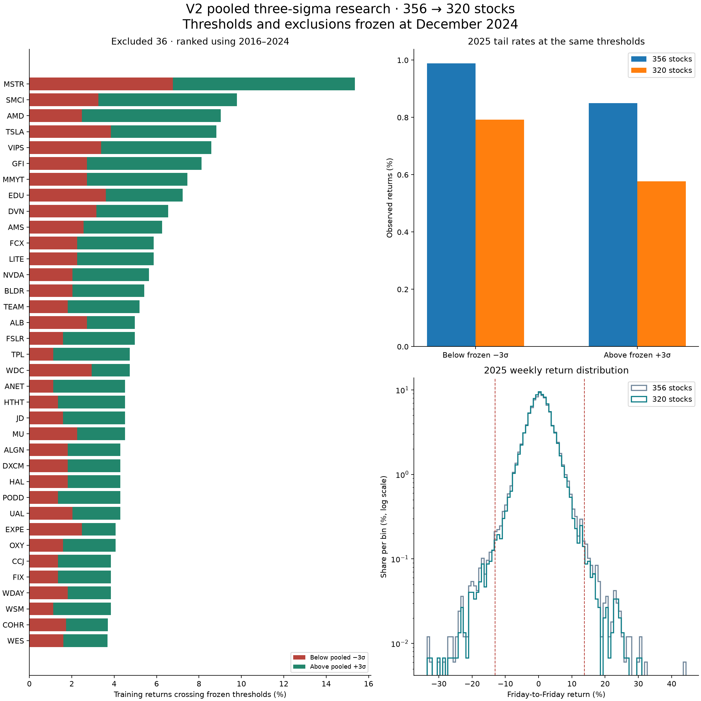
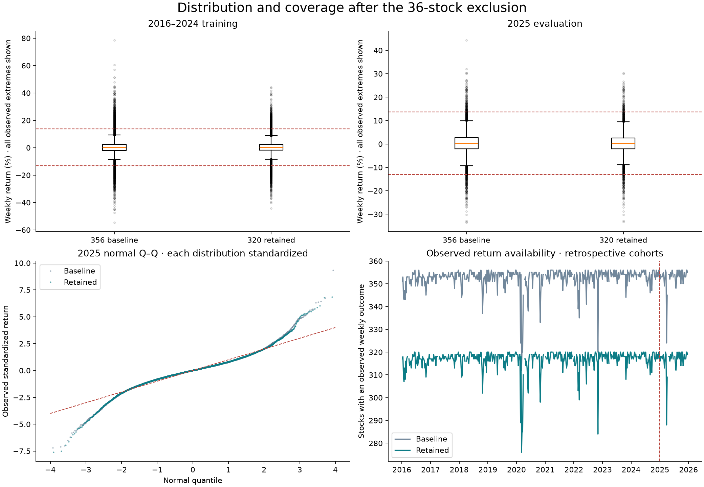

# Exclude the top decile by pooled three-sigma crossing rate

## Protocol recorded before this run

Start with the existing 356-stock cohort, as requested. Use the audited `forward_return` labels in `data/friday/friday_dataset.parquet`. These are Friday-close to the next calendar Friday-close returns. Preserve Friday holidays and unresolved observations as missing. News availability does not determine eligibility for this price-only diagnostic.

Fit the pooled mean and sample standard deviation on all observed stock-week returns whose outcome ends by December 31, 2024. Count each stock's returns strictly below `mean - 3*std` or strictly above `mean + 3*std`. Rank by crossings divided by that stock's observed training returns. Require at least 30 observed training returns and positive within-stock variance for ranking eligibility. Break ties by total crossing count, then ticker alphabetically. Exclude `ceil(356 * 0.10) = 36` stocks, leaving 320. Export within-stock three-sigma crossing rates for context, while the primary selection uses the common pooled thresholds.

Freeze both the thresholds and the exclusion list before examining 2025 outcomes. Compare 2016–2024 training and 2025 evaluation counts, positive and negative tail rates, return dispersion, box plots, normal Q–Q plots, and return availability. Use the same fitted thresholds for before/after tail comparisons. Preserve the original data. Export the ranking, retained and excluded names, weekly returns, and a separate filtered Friday panel. Recompute realized outcome ranks within the retained cohort, and tag that panel with the December 2024 universe-selection cutoff. Its earlier rows can be used as retrospective training data for a model fitted after that cutoff. They do not represent a universe known in 2016.

Also report the average number of realized 2025 top-15 winners excluded by this rule as an opportunity-cost diagnostic. Those future winners are used only for evaluation. This study does not train a predictor or simulate an executable portfolio. Large verified market moves remain valid observations. The exclusion is a research risk rule.

The August 2026 frozen roster, previous use of 2025, and the first-Friday cohort introduce research limitations. Treat the results as exploratory. The earlier 356-to-346 experiment excluded ten tickers by full-period box-whisker crossings. The new experiment uses 36 tickers, audited returns, pooled three-sigma thresholds, and a training-period selection cutoff.

The histogram, box plot, and normal Q–Q checks follow the [MSDS 401 normality EDA practice](../../../NW_MSDS/MSDS_401/practice/normality_eda/questions.md). Here each observation is an audited stock-week return. The pooled distribution mixes stocks and market regimes, and observations within a week are dependent. Three sigma is a descriptive cutoff; it does not establish normality, a 0.27% expected crossing rate, or statistical significance. Exclusion removes both upside and downside moves, so a reduction in tail rates alone cannot establish better stock selection.

## Results

The fitted pooled mean is 0.3157% and sample standard deviation is 4.4723%. The frozen thresholds are **-13.1011%** and **13.7326%**. The fit uses 156,159 audited training outcomes. Exactly 36 of 356 stocks are excluded, leaving 320.

| Period | Cohort | Stocks | Observed returns | Tail crossings | Crossing rate | Weekly return σ |
| --- | --- | --- | --- | --- | --- | --- |
| training | baseline | 356 | 156159 | 2288 | 1.465% | 4.472% |
| training | retained | 320 | 140283 | 1384 | 0.987% | 4.094% |
| evaluation | baseline | 356 | 16580 | 305 | 1.840% | 4.709% |
| evaluation | retained | 320 | 14890 | 204 | 1.370% | 4.394% |
| full_archive | baseline | 356 | 173095 | 2593 | 1.498% | 4.492% |
| full_archive | retained | 320 | 155493 | 1588 | 1.021% | 4.121% |

The 2025 tail-rate difference, retained minus baseline, is -0.470 percentage points at the same thresholds. The hindsight opportunity-cost diagnostic finds an average of 4.04 excluded stocks among each observed week's realized top 15 across 47 evaluation weeks. This describes the trade-off between reducing extremes and retaining potential winners. It leaves the performance of a trained top-15 strategy unresolved.

### Excluded stocks

| Stock | Observed training returns | Below −3σ | Above +3σ | Crossing rate |
| --- | --- | --- | --- | --- |
| MSTR | 443 | 30 | 38 | 15.35% |
| SMCI | 429 | 14 | 28 | 9.79% |
| AMD | 443 | 11 | 29 | 9.03% |
| TSLA | 442 | 17 | 22 | 8.82% |
| VIPS | 443 | 15 | 23 | 8.58% |
| GFI | 443 | 12 | 24 | 8.13% |
| MMYT | 443 | 12 | 21 | 7.45% |
| EDU | 443 | 16 | 16 | 7.22% |
| DVN | 443 | 14 | 15 | 6.55% |
| AMS | 431 | 11 | 16 | 6.26% |
| FCX | 443 | 10 | 16 | 5.87% |
| LITE | 443 | 10 | 16 | 5.87% |
| NVDA | 443 | 9 | 16 | 5.64% |
| BLDR | 443 | 9 | 15 | 5.42% |
| TEAM | 443 | 8 | 15 | 5.19% |
| ALB | 443 | 12 | 10 | 4.97% |
| FSLR | 443 | 7 | 15 | 4.97% |
| TPL | 443 | 5 | 16 | 4.74% |
| WDC | 443 | 13 | 8 | 4.74% |
| ANET | 443 | 5 | 15 | 4.51% |
| HTHT | 443 | 6 | 14 | 4.51% |
| JD | 443 | 7 | 13 | 4.51% |
| MU | 443 | 10 | 10 | 4.51% |
| ALGN | 443 | 8 | 11 | 4.29% |
| DXCM | 443 | 8 | 11 | 4.29% |
| HAL | 443 | 8 | 11 | 4.29% |
| PODD | 443 | 6 | 13 | 4.29% |
| UAL | 443 | 9 | 10 | 4.29% |
| EXPE | 443 | 11 | 7 | 4.06% |
| OXY | 443 | 7 | 11 | 4.06% |
| CCJ | 443 | 6 | 11 | 3.84% |
| FIX | 443 | 6 | 11 | 3.84% |
| WDAY | 443 | 8 | 9 | 3.84% |
| WSM | 443 | 5 | 12 | 3.84% |
| COHR | 406 | 7 | 8 | 3.69% |
| WES | 435 | 7 | 9 | 3.68% |

### Reproduce and use the cohort

Run `python scratch/AlphaAllocationV2/sigma_tail_filter.py` with numpy, pandas, DuckDB, matplotlib, and scipy installed. The [summary](data/sigma_top_decile/summary.json) records the cutoff, methods, hashes, and results. [All stock rankings](data/sigma_top_decile/stock_rankings.csv), [excluded names](data/sigma_top_decile/excluded_stocks.csv), [retained names](data/sigma_top_decile/retained_symbols.json), and [weekly opportunity counts](data/sigma_top_decile/opportunity_cost_2025.csv) support review. The [separate retained Friday panel](data/sigma_top_decile/friday_dataset_320.parquet) preserves all source fields and observations for retained names, recomputes outcome ranks, and adds `universe_selection_as_of`. Its selection cutoff must be respected when interpreting earlier rows.

Stocks are ranked by pooled-threshold crossing rate. The exported within-stock sigma rates use each ticker's own mean and standard deviation and answer a different question. This study uses audited labels, so its counts differ from the original raw-return box-plot experiment. Tail flags describe large observed moves. The fixed exclusion is an exploratory universe policy whose prediction and execution performance still needs evaluation.
