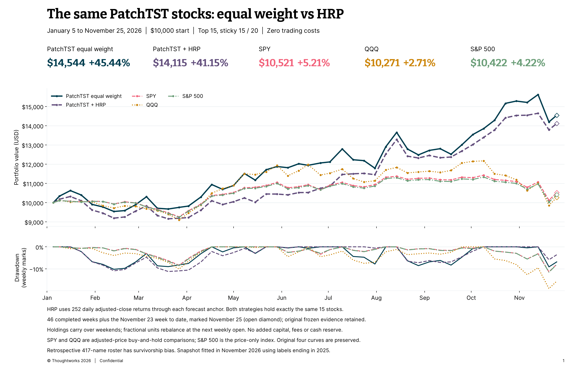

# Fixed 2025 PatchTST snapshot: equal weight versus HRP in 2026

Using HRP weights on the **same 15 PatchTST-selected stocks each week** produces
**$14,115.23 (+41.15%)**, compared with **$14,543.95 (+45.44%)** for equal weight.
HRP finishes **$428.71 lower, a 4.29-percentage-point return gap**, and its maximum
drawdown at the sampled marks is larger. This matched replay does not provide
evidence that HRP improved this particular portfolio over this period.

| Portfolio | Ending value | Total return | Maximum drawdown at sampled marks |
| --- | ---: | ---: | ---: |
| PatchTST equal weight | $14,543.95 | +45.44% | 10.22% |
| PatchTST + HRP | $14,115.23 | +41.15% | 11.23% |
| SPY | $10,520.84 | +5.21% | 11.40% |
| QQQ | $10,270.76 | +2.71% | 19.01% |
| S&P 500 | $10,421.62 | +4.22% | 11.54% |



## Scope and duplicate check

The reference is [the original snapshot replay](../patchtst_2025_snapshot_2026_replay/README.md).
Before execution, the scratch runners, reports and summary files were searched
for that folder and snapshot identifier. The existing legacy 12-stock
`patchtst_era_walkforward_2026_halal/exp_ptst_vs_hrp` and the separate SAC HRP
charts use different rosters, forecasts or periods. No matching snapshot replay
with HRP was found.

This directory contains only the additional HRP simulation and comparison
exports. The existing equal-weight simulation, three benchmarks, forecasts,
selected stocks, news inputs and price evidence are reused. No new price fetch,
model inference or training was needed. Every file in the original experiment
was hashed before execution and verified unchanged afterward. The runner skips
an already completed experiment with the same inputs and code and refuses to
overwrite a result with a different identity or changed output hashes.

## Matched experiment contract

- Snapshot: `snapshot-2025-12-31-12d23440a2a3`, from `patchtst_halal_new`.
  Its latest training label ends December 29, 2025. The snapshot itself was
  fitted in November 2026; it was not available in January 2026.
- Starting capital: $10,000 at the January 5, 2026 open. The replay retains
  the original **46 complete weeks plus one final week-to-date mark through
  November 25, 2026**. It is not a full-calendar-year 2026 result.
- The original price evidence was captured at
  `2026-11-27T17:52:00.086227+00:00`, before November 27's shortened US session
  closed. That unfinished daily candle stays excluded. No newer data was mixed
  into the comparison.
- The 417-name snapshot roster, weekly forecasts, eligible stocks and 15/20
  rank-band sticky selections are unchanged. The runner independently checks
  that saved selections agree with `select_with_rank_band`. The HRP arm has
  exactly the same 15 names as equal weight on every decision date.
- HRP uses **252 daily simple adjusted-close returns from exactly 253 exchange
  sessions**, ending at the original forecast anchor before Monday's decision.
  No current-week or future price enters covariance estimation. Missing,
  nonpositive or non-finite selected-stock history aborts; no selected name is
  silently excluded or replaced. All 705 selected-stock histories pass.
- Portfolio targets reuse production `compute_hrp_weights`: sample covariance
  and correlation, correlation-distance single-linkage clustering, ordered
  leaves and recursive bisection. Full-precision weights sum to one. They
  allocate all capital across the selected stocks, with no cash buffer, extra
  screen, second HRP stage or change to sticky selection.
- Both strategies hold their actual positions across weekends. At the next
  weekly execution open, existing positions are marked at that open, then the
  current NAV is rebalanced to the new targets. Sales finance buys. Fractional
  adjusted-price units are allowed; no additional capital is deposited.
- Fees, spreads, slippage, taxes, market impact and cash interest are zero,
  matching the original replay. Final holdings are marked, not liquidated.
- SPY and QQQ remain adjusted-price buy-and-hold comparisons. S&P 500 remains
  the `^GSPC` price index, which excludes dividends. All five series share
  exactly the same starting point and valuation dates.

## Evidence and verification

- `weekly_nav.csv`: all four original series plus `PatchTST + HRP`; the four
  original columns have zero numerical difference at every mark.
- `hrp_weekly_holdings.csv` / `hrp_ending_holdings.csv`: target and actual
  closing weights, fractional units, prices and position values.
- `hrp_trades.csv` / `hrp_weekly_ledger.json`: trade deltas, current-NAV
  rebalances, selections, return history dates, target weights and accounting.
- `hrp_weekly_portfolio.csv`: per-week opening and closing NAV, returns,
  turnover, history cutoffs and covariance-input return hashes.
- `summary.json`: parameters, results, limitations, original file hashes,
  runner and production HRP hashes, and output checksums.
- `validation.json`: 47 reconciled weekly books, 705 holdings and 705 weight
  comparisons with production's high-level HRP facade. Differences are within
  its four-decimal percentage rounding. The largest self-financing residual
  is below $0.0000001. Three first/middle/last-week future-price perturbations
  leave earlier HRP targets exactly unchanged.
- `weekly_performance_2026.png` / `.svg`: five-series portfolio value and
  drawdown chart, visually inspected after rendering.

The 15 new synthetic offline tests cover known inverse-variance HRP math,
future-price exclusion, missing exchange sessions, invalid histories and
targets, weekend gaps, self-financing rebalances, missing held-stock prices,
two-week position carry, duplicate skipping and changed-input refusal. The
original 11 replay tests are also retained. The repository's external-I/O guard
is active. Ruff lint and format checks apply to this new folder.

The source experiment retains survivorship and membership bias from applying a
later roster historically. It is a retrospective out-of-time experiment, not
a contemporaneous track record or an independent test of expected future
returns. The original seven-feature/news inputs and archive limitations also
carry through. Model targets span five trading sessions and can extend beyond
Friday in holiday weeks. Drawdowns use the sampled weekly and final partial-week
marks; they do not measure daily or intraday drawdown. These results exclude
trading costs and cover one reused period without statistical uncertainty
estimates.

An additional [IBKR fee comparison](ibkr_fees/README.md) retains these zero-fee
results and evaluates both allocations under the repository fee convention
and a sensitivity charging every trade. Its account values, fee breakdowns
and trade ledgers live separately in `ibkr_fees/`.

Production code, model artifacts and current pointers, news and sticky history,
broker accounts, workflows and email are unchanged. No publication or commit
was performed.

## Reproduce from the repository root

The original experiment folder is a read-only evidence dependency. Keep it
alongside this folder; its hashes are recorded in `summary.json`.

```sh
PYTHONPATH=.:brain_api brain_api/.venv/bin/python scratch/patchtst_2025_snapshot_2026_hrp_replay/run.py
PYTHONPATH=.:brain_api brain_api/.venv/bin/python scratch/patchtst_2025_snapshot_2026_hrp_replay/validate.py
PYTHONPATH=.:brain_api:scratch/patchtst_2025_snapshot_2026_hrp_replay:scratch/patchtst_2025_snapshot_2026_replay brain_api/.venv/bin/python -m pytest -q scratch/patchtst_2025_snapshot_2026_hrp_replay/test_hrp_replay.py scratch/patchtst_2025_snapshot_2026_replay/test_replay.py
brain_api/.venv/bin/ruff check --config brain_api/pyproject.toml scratch/patchtst_2025_snapshot_2026_hrp_replay
brain_api/.venv/bin/ruff format --check --config brain_api/pyproject.toml scratch/patchtst_2025_snapshot_2026_hrp_replay
PYTHONPATH=scratch/ppo_prod_refresh_2026_11_07/data/chart_dependencies MPLCONFIGDIR=/private/tmp/patchtst-hrp-matplotlib XDG_CACHE_HOME=/private/tmp/patchtst-hrp-chart-cache brain_api/.venv/bin/python scratch/patchtst_2025_snapshot_2026_hrp_replay/plot.py
```

The first command detects these completed results and skips recalculation.
The chart reuses the original experiment's Bitter and Inter fonts and the
existing scratch Matplotlib installation; no dependency or lockfile changed.
