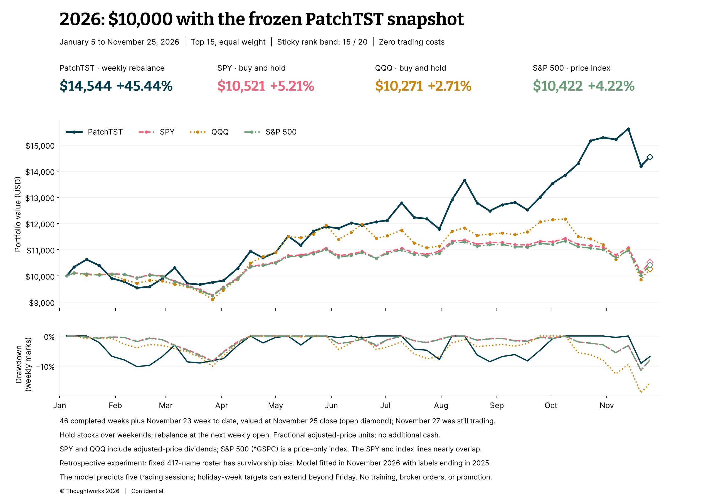

# Fixed 2025 PatchTST snapshot: 2026 weekly replay

Starting with **$10,000 on January 5, 2026**, the portfolio reaches
**$14,543.95 (+45.44%)**
at November 25's close. Holdings carry over weekends and are rebalanced to
15 equal weights at each week's first session open. All modeled trading costs
are zero. No additional capital is deposited.

| Portfolio | Ending value | Total return | Maximum drawdown at sampled marks |
| --- | ---: | ---: | ---: |
| PatchTST | $14,543.95 | +45.44% | 10.22% |
| SPY | $10,520.84 | +5.21% | 11.40% |
| QQQ | $10,270.76 | +2.71% | 19.01% |
| S&P 500 | $10,421.62 | +4.22% | 11.54% |



## Time boundary

The price evidence was captured at **2026-11-27T17:52:00.086227+00:00**.
Although the Singapore calendar date was November 28, the shortened US
November 27 session had not yet closed (scheduled close: 18:00 UTC,
November 28 at 02:00 Singapore time). Its unfinished daily candle is excluded.
There are **46 completed weekly points through November 20**, plus a marked
week-to-date point at **November 25's close**, the latest completed session
at capture. The starting $10,000 point is also shown.

This report does not present the unfinished November 27 bar as a Friday close.
The final week is incomplete; it is not directly comparable to a full weekly
return. All four curves use the same valuation dates.

## Frozen experiment contract

- Model: `snapshot-2025-12-31-12d23440a2a3` from the US `patchtst_halal_new` bucket, loaded through
  `PatchTSTHalalNewModelStorage.load_version_artifacts`. Weights, architecture,
  and fitted target scale are unchanged. No training or model promotion occurs.
- Snapshot creation: November 27, 2026. Data cutoff: December 31, 2025;
  latest actual training label ends December 29, 2025. This is retrospective
  testing of a newly fitted artifact, not an artifact available in January.
- Roster: all **417 snapshot symbols**, frozen across the experiment, including
  any ETFs in the original roster. The roster is not reconstructed historically.
- Inputs: the snapshot's seven original features: 20-session momentum,
  12-minus-1 momentum, 20-session annualized realized volatility, relative
  volume, archived news sentiment, adjusted close, and volume. The context is
  365 calendar days, padded to 255 sessions. Production feature construction,
  missingness checks, window normalization, and target inversion are reused.
- Every prediction uses the latest session completed before its Monday.
  Monday's opening/closing bars are not prediction inputs. A Monday holiday
  executes at Tuesday's open; a Friday holiday values at the week's final
  trading-session close. No forecast is used before its input cutoff.
- Rank scores descending, ties by symbol ascending. On the first week choose
  the highest 15. Subsequently retain previous selections ranked 20 or better,
  then fill to 15 with the highest-ranked remaining symbols. The exact production
  `select_with_rank_band` primitive is used, without production sticky history.
- **393 to 408 names qualify per week**. There are 19,066 finite stock forecasts
  and 533 excluded stock-week windows, all exported. Missing required inputs
  never become zero forecasts or substitute ranking signals. All 420 requested
  price histories (417 roster names plus three benchmarks) were retrieved.
- At each execution open, mark the actual previous holdings using that open,
  then trade only their differences from the new equal-weight targets.
  Sales finance purchases; there is no fresh $10,000 injection. Friday values
  are reporting marks, not cash liquidation. Weekend gaps remain in the account.
- Friday holdings drift from equal weights as prices move. The next rebalance
  restores each selected name to 1/15 of current NAV. Average retained names
  after the first week: **9.78**.
- Initial and later allocations allow fractional adjusted-price units.
  Fees, spread, slippage, tax, market impact, and cash interest are zero.
  Stocks are still held at the final mark; no terminal liquidation is modeled.
- SPY and QQQ invest $10,000 at the same first open and then hold. The S&P 500
  line normalizes the `^GSPC` price index to $10,000 at that open; it represents
  an index comparison rather than a directly tradable holding.

## Forecast horizon and research limits

The artifact forecasts **five exchange sessions**, not a variable horizon ending
on every calendar Friday. Its target therefore extends beyond Friday for the
weeks beginning January 19, February 16, March 30, May 25, June 15, June 29, September 07, November 23. The existing model's original score is retained;
realized account values are still marked on the stated weekly dates.

The current roster applied historically introduces **survivorship and membership
bias**. The model was fitted after this test period with pre-2026 labels; this
is a retrospective, out-of-time scratch experiment and not a live track record
or an independent confirmation of expected future returns.

Prices are Yahoo Finance adjusted OHLCV (`auto_adjust=True`), so corporate
splits and distributions are reflected in the price series. Positions are
adjusted-price units, not historical broker share counts. SPY and QQQ include
the adjusted-price dividend effect; `^GSPC` excludes dividends. This explains
part of the SPY-versus-index difference. No provider gap is forward-filled for
an execution or valuation price; a missing held-stock mark aborts the run.

News is read through the production causal session-sentiment query, using a
DuckDB connection opened **read-only**. Unavailable article revisions and
incomplete coverage remain missing under the original model's checks. Frozen
feature arrays preserve the exact evidence used for this run; the full live
news database is neither copied nor modified. Archive limitations and any
historical data revisions remain limitations. Maximum drawdown is computed
from the plotted marks, not daily or intraday prices.

## Latest holdings: November 25 close

Ending cash: **$0**. These 15 positions sum to the reported NAV.

| Symbol | Adjusted units | Adjusted close | Market value | Actual weight |
| --- | ---: | ---: | ---: | ---: |
| FIX | 0.85009491 | $1,099.5800 | $934.75 | 6.43% |
| FFIV | 3.15832966 | $317.0500 | $1,001.35 | 6.88% |
| ASM | 261.01457285 | $3.6900 | $963.14 | 6.62% |
| SAR | 92.46272355 | $10.8600 | $1,004.15 | 6.90% |
| HLN | 111.98837527 | $9.4300 | $1,056.05 | 7.26% |
| NTOIY | 75.36059571 | $12.7700 | $962.35 | 6.62% |
| MTZ | 6.15660884 | $154.1700 | $949.16 | 6.53% |
| COO | 16.87935196 | $62.2900 | $1,051.41 | 7.23% |
| MRVL | 6.86645152 | $130.9300 | $899.02 | 6.18% |
| CTVA | 125.44380051 | $8.2300 | $1,032.40 | 7.10% |
| NVDA | 6.00033512 | $149.3000 | $895.85 | 6.16% |
| ILMN | 4.85961667 | $200.3900 | $973.82 | 6.70% |
| ASX | 30.27169794 | $29.4900 | $892.71 | 6.14% |
| BKR | 21.42573671 | $46.3600 | $993.30 | 6.83% |
| TPL | 3.57528697 | $261.3700 | $934.47 | 6.43% |

## Files and verification

- `weekly_performance_2026.png` / `.svg`: chart, one observation per week plus start.
- `weekly_nav.csv`: all four account values on every plotted date.
- `weekly_portfolio.csv`: every week's opening NAV, ending NAV, returns, carry
  count, selected names, execution date and valuation date.
- `weekly_holdings.csv` / `ending_holdings.csv`: units, prices, values and weights.
- `forecasts.csv`: every finite prediction, rank, input anchor and model target date.
- `exclusions.csv`: every rejected stock-week input window.
- `trades.csv` / `weekly_ledger.json`: quantities, opening prices, cash-flow
  reconciliation, selections, evictions and full weekly accounting.
- `price_manifest.json` / `data/inputs_identity.json`: provider configuration,
  artifact hashes, input hashes, feature implementation hashes and news inventory.
- `summary.json`: parameters, metrics, source revision and runner source hashes.
- `validation.json`: all 47 books, 705 holdings rows, and three benchmarks
  independently reconciled. Cash-flow residual is below $0.0000001. Three
  future-input perturbation checks leave earlier input windows unchanged.

The 11 synthetic offline tests pass. They cover fractional initial allocation,
weekend gaps and self-financing trades, invalid held-price rejection, rank-20
retention/rank-21 eviction, exchange holidays, incomplete-session exclusion,
and a two-week integration replay. Ruff lint and format checks pass for this
experiment. The production offline I/O guard is active in these tests.

Only this scratch directory and temporary chart caches are written. Production
model files and `current`, news and sticky databases, workflows, broker accounts,
and email are unchanged. Git revision at execution: `91e8a28017c8d2ae975b46274d8c1e944c45274e`.
No commit or publication was performed.

## Reproduce from repository root

The evidence is already frozen; `replay.py` verifies its hashes and reuses it.
The original `prepare.py` download step is needed only to reproduce acquisition
in a fresh experiment directory; rerunning it is unnecessary for these results.

```sh
PYTHONPATH=brain_api brain_api/.venv/bin/python scratch/patchtst_2025_snapshot_2026_replay/replay.py
PYTHONPATH=brain_api brain_api/.venv/bin/python scratch/patchtst_2025_snapshot_2026_replay/validate.py
PYTHONPATH=brain_api:scratch/patchtst_2025_snapshot_2026_replay brain_api/.venv/bin/python -m pytest -q scratch/patchtst_2025_snapshot_2026_replay/test_replay.py
brain_api/.venv/bin/ruff check --config brain_api/pyproject.toml scratch/patchtst_2025_snapshot_2026_replay
brain_api/.venv/bin/ruff format --check --config brain_api/pyproject.toml scratch/patchtst_2025_snapshot_2026_replay
PYTHONPATH=scratch/ppo_prod_refresh_2026_11_07/data/chart_dependencies MPLCONFIGDIR=/private/tmp/patchtst-matplotlib XDG_CACHE_HOME=/private/tmp/patchtst-chart-cache brain_api/.venv/bin/python scratch/patchtst_2025_snapshot_2026_replay/plot.py
```

Plotting reuses the existing scratch Matplotlib installation and copied Bitter
and Inter fonts. No production dependency or lockfile was changed.
