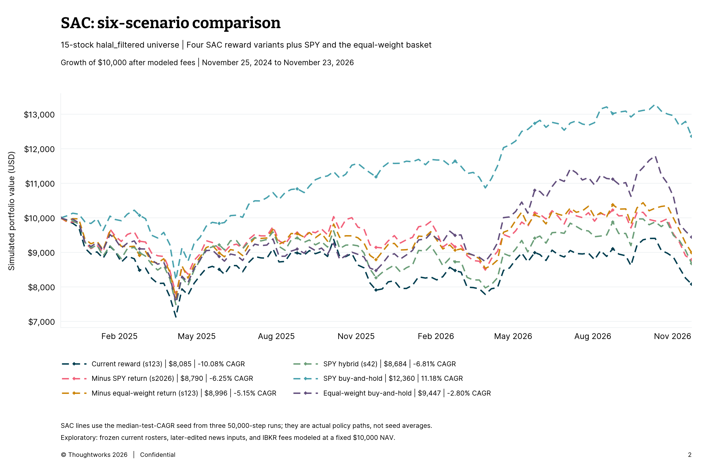
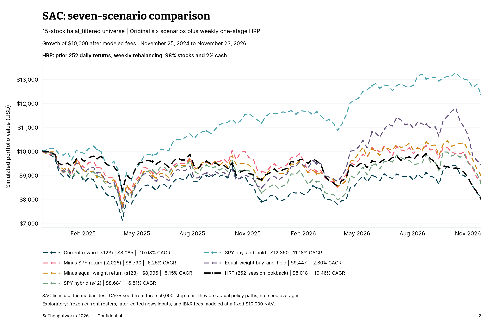

# SAC halal_filtered reward experiment results against SPY

Completed November 28, 2026. Research results only; production was unchanged.

All 12 runs completed: four rewards, three matched seeds each, 50,000 steps per run. 360 training weeks and 104 held-out weeks, 2024-11-25 to 2026-11-23. Returns include the existing IBKR Singapore Tiered model at fixed USD 10,000 NAV. Sharpe assumes zero risk-free rate.

**The historical panel includes survivor-selected stocks and later-edited news. These are biased exploratory results, not an unbiased investment backtest.**

## Performance

SAC entries are medians across all three seeds. Benchmarks are independent buy-and-hold portfolios with an IBKR entry fee. No winning seed was selected.

| Strategy | CAGR | Sharpe | Max drawdown |
| --- | ---: | ---: | ---: |
| SPY_buy_hold | 11.18% | 0.708 | 19.68% |
| halal_filtered_equal_weight_buy_hold | -2.80% | -0.026 | 24.44% |
| SAC current | -10.08% | -0.414 | 23.95% |
| SAC spy_excess | -6.25% | -0.218 | 23.98% |
| SAC equal_weight_excess | -5.15% | -0.145 | 24.48% |
| SAC spy_hybrid | -6.81% | -0.212 | 24.21% |

## Improvement against current reward

Paired differences compare the same seed under identical data and training budgets.

| Reward | Median paired CAGR change (pp) | Median paired Sharpe change | Seeds improving both | Seeds beating SPY on both | Seeds beating equal weight on both |
| --- | ---: | ---: | ---: | ---: | ---: |
| current | +0.00 | +0.000 | 0/3 | 0/3 | 1/3 |
| spy_excess | +1.23 | +0.088 | 2/3 | 0/3 | 0/3 |
| equal_weight_excess | +4.93 | +0.269 | 2/3 | 0/3 | 1/3 |
| spy_hybrid | +1.45 | +0.094 | 2/3 | 0/3 | 1/3 |

## Individual seeds

| Reward | Seed | CAGR | Sharpe | Average cash | Average weekly turnover | Fees over 104 weeks (USD, fixed NAV) |
| --- | ---: | ---: | ---: | ---: | ---: | ---: |
| current | 42 | -1.96% | 0.002 | 7.81% | 32.26% | 467.15 |
| current | 123 | -10.08% | -0.414 | 8.87% | 29.02% | 461.91 |
| current | 2026 | -10.95% | -0.492 | 2.72% | 31.61% | 463.74 |
| spy_excess | 42 | -5.00% | -0.142 | 2.81% | 33.51% | 451.55 |
| spy_excess | 123 | -8.86% | -0.326 | 2.37% | 33.59% | 470.75 |
| spy_excess | 2026 | -6.25% | -0.218 | 6.64% | 34.12% | 465.82 |
| equal_weight_excess | 42 | -11.73% | -0.455 | 2.31% | 32.80% | 472.65 |
| equal_weight_excess | 123 | -5.15% | -0.145 | 2.15% | 27.59% | 474.62 |
| equal_weight_excess | 2026 | -2.44% | -0.014 | 3.52% | 31.30% | 473.32 |
| spy_hybrid | 42 | -6.81% | -0.212 | 4.62% | 34.34% | 471.83 |
| spy_hybrid | 123 | -8.63% | -0.321 | 3.75% | 27.92% | 474.43 |
| spy_hybrid | 2026 | 1.34% | 0.163 | 12.25% | 31.07% | 468.73 |

## Execution sensitivity

Evaluation only, without retraining. Every executed delta pays IBKR fees; deadbands freeze small trades. Slippage is charged per stock notional traded. Values are medians across three seeds. These are alternate execution assumptions, separate from the matched reward experiment.

| Reward | True deadband | Slippage (bps) | CAGR | Sharpe | Fees and slippage (USD, fixed NAV) |
| --- | ---: | ---: | ---: | ---: | ---: |
| current | 0% | 0 | -10.34% | -0.428 | 519.43 |
| current | 1% | 0 | -9.86% | -0.401 | 407.39 |
| current | 2% | 0 | -9.25% | -0.379 | 335.64 |
| current | 0% | 10 | -12.89% | -0.568 | 1158.63 |
| equal_weight_excess | 0% | 0 | -5.40% | -0.157 | 525.67 |
| equal_weight_excess | 1% | 0 | -5.09% | -0.142 | 416.23 |
| equal_weight_excess | 2% | 0 | -3.81% | -0.082 | 336.36 |
| equal_weight_excess | 0% | 10 | -8.02% | -0.290 | 1153.44 |
| spy_excess | 0% | 0 | -6.50% | -0.231 | 520.65 |
| spy_excess | 1% | 0 | -5.89% | -0.199 | 414.07 |
| spy_excess | 2% | 0 | -6.45% | -0.231 | 348.51 |
| spy_excess | 0% | 10 | -9.61% | -0.397 | 1198.89 |
| spy_hybrid | 0% | 0 | -7.05% | -0.224 | 523.52 |
| spy_hybrid | 1% | 0 | -6.75% | -0.209 | 419.19 |
| spy_hybrid | 2% | 0 | -5.31% | -0.141 | 338.76 |
| spy_hybrid | 0% | 10 | -10.19% | -0.380 | 1143.71 |

## Interpretation

Equal-weight-relative reward produced median CAGR -5.15% and median Sharpe -0.145. Changes versus current reward: +4.93 percentage points of median CAGR and +0.269 of median Sharpe. It improved both metrics in 2 of three paired seeds.

No alternative reward improved both CAGR and Sharpe in all three paired seeds. Any median improvement should be treated as seed-sensitive evidence.

An action-independent benchmark subtraction preserves the ideal unnormalized objective ranking. Differences here reflect learning, normalization, and approximation. The hybrid changes the reward sign convention, not the ideal action ranking. See the experiment README for formulas, assumptions, and reproduction commands.

Integrity checks are recorded in verification.json: all input hashes unchanged, all traces aligned to the same 104 weeks, finite constrained weights, metrics independently recomputed, and 48 execution sensitivity evaluations present.

Total training time: 59.2 minutes. All results, models, and evidence remain in this scratch directory. No production model was promoted.

## Portfolio growth graphs

The four SAC curves use the actual median-CAGR seed for each reward. The tables
above summarize all three seeds; a plotted seed's Sharpe can differ from the
median Sharpe. All curves start at USD 10,000 over the same two-year window.

[Vector SVG](../../sac_reward_comparison_charts_2026_11_28/02_sac_halal_filtered.svg) · [Plotted values](../../sac_reward_comparison_charts_2026_11_28/02_sac_halal_filtered.csv)

[Vector SVG](../../sac_hrp_comparison_charts_2026_11_28/02_sac_halal_filtered_with_hrp.svg) · [Plotted values](../../sac_hrp_comparison_charts_2026_11_28/02_sac_halal_filtered_with_hrp.csv)

[Combined twelve-line graph](../../sac_reward_comparison_charts_2026_11_28/03_all_12_scenarios.png) ·
[HRP methodology](../../sac_hrp_comparison_charts_2026_11_28/README.md)
