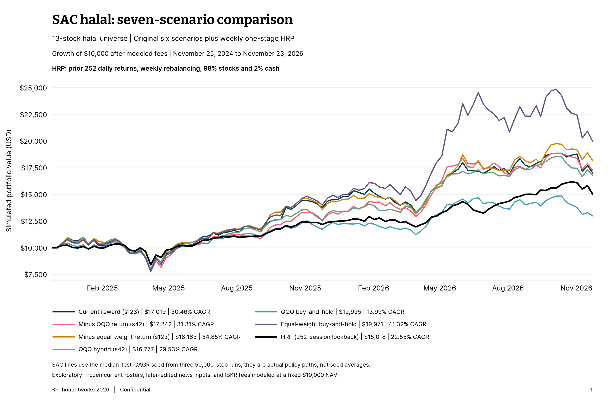
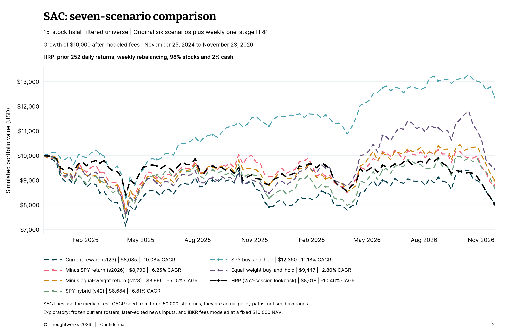

# Seven-line SAC comparison copies with one-year HRP

The graphs below load directly from committed PNG files, with SVG and CSV
exports beside them.

[Vector SVG](01_sac_halal_with_hrp.svg) · [Plotted values](01_sac_halal_with_hrp.csv)

[Vector SVG](02_sac_halal_filtered_with_hrp.svg) · [Plotted values](02_sac_halal_filtered_with_hrp.csv)

[Original six-line graphs and combined twelve-line graph](../sac_reward_comparison_charts_2026_11_28/README.md)

These two new graph copies retain the six original scenario curves and add
weekly one-stage Hierarchical Risk Parity on each experiment's full frozen
stock roster. The original six-line graphs and combined twelve-line graph
remain unchanged.

The user confirmed the same two-year plot window, November 25, 2024 through
November 23, 2026, with a 252-session HRP lookback. Every weekly decision uses
exactly 252 adjusted daily close returns, requiring 253 closes, through the
preceding calendar Friday or its latest available trading session. No future
close, current-week return, news, or forecast enters the HRP calculation.

The HRP math is reused from `brain_api.core.hrp.compute_hrp_weights`: single
linkage correlation-distance clustering, quasi-diagonal order and recursive
bisection. No stock screen, top-K step, sticky selector or second HRP stage is
added. The `halal` roster contains 13 stocks; `halal_filtered` contains 15.
The comparison keeps those exact rosters, rather than inventing two stocks
for the smaller universe.

HRP stock weights are scaled to 98% with a 2% target cash reserve, matching
the existing SAC cash minimum. Both stock and cash weights drift after weekly
returns and fees. Rebalances use the same first-XNYS-open to next-week-open
price evidence and IBKR Singapore Tiered cost configuration at fixed USD
10,000 NAV, including the existing 0.5-percentage-point fee exemption. The
new HRP line therefore inherits the original experiment's cost assumptions.

All curves begin at USD 10,000. The first six lines preserve the previously
chosen median-CAGR SAC seeds and the passive benchmarks. HRP is deterministic
and has no training seed. Black identifies the additional HRP line. Each new
plot contains exactly seven data series over the same 105 endpoints.

These remain exploratory comparisons using current rosters applied backward.
The SAC lines also inherit the documented later-edited-news input bias; HRP
uses only past adjusted prices. No production model, current pointer,
strategy partition, workflow or account is changed.

Run `add_hrp.py` with the repository's Python environment and `PYTHONPATH`
pointing to `brain_api`; run `draw_hrp_charts.py` in the same temporary plotting
runtime used for the original figures (Matplotlib 3.10.7, Bitter Bold and
Inter fonts). The source return CSVs, HRP target weights, per-week cutoff dates,
metrics, source hashes, vector SVGs and PNGs are included with the exports.
