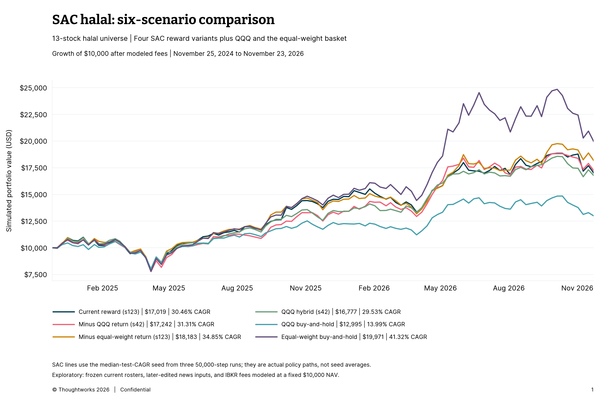
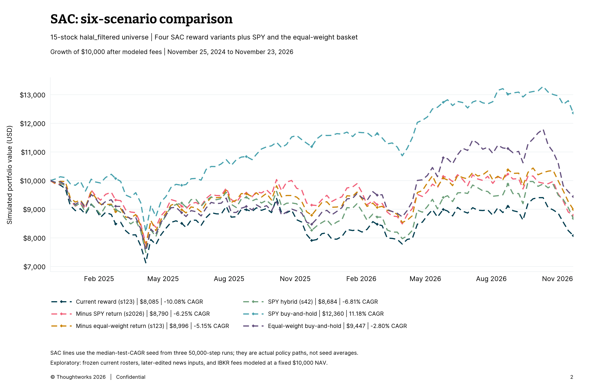
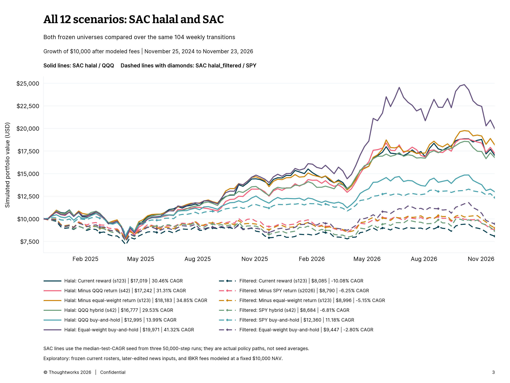

# SAC reward comparison charts

The graphs below load directly from committed PNG files. Each also has a
vector SVG and CSV export beside it.

[Vector SVG](01_sac_halal.svg) · [Plotted values](01_sac_halal.csv)

[Vector SVG](02_sac_halal_filtered.svg) · [Plotted values](02_sac_halal_filtered.csv)

[Vector SVG](03_all_12_scenarios.svg) · [Plotted values](03_all_12_scenarios.csv)

[Seven-line copies with HRP](../sac_hrp_comparison_charts_2026_11_28/README.md)

Three graphs show simulated growth of USD 10,000 over the common held-out
window, November 25, 2024 to November 23, 2026:

1. `01_sac_halal`: six lines for the 13-stock halal / QQQ experiment.
2. `02_sac_halal_filtered`: six lines for the 15-stock halal_filtered / SPY experiment.
3. `03_all_12_scenarios`: all twelve lines together.

There are four trained reward variants per experiment and two passive
benchmarks, making six lines per graph. Execution sensitivity variants are not
included in these six. The combined graph uses matching colors by strategy
family, solid lines for halal and dashed lines with diamonds for halal_filtered.

Each trained-policy curve is the actual seed with median test CAGR among
seeds 42, 123, 2026, matching the production experiment's median-CAGR selection
rule. This is not a pointwise median or an ensemble of weekly returns. Each
legend identifies the selected seed, terminal value, and CAGR. The Sharpe of a
selected seed may differ from the median Sharpe across all three seeds in the
earlier summary table. Actual selected-seed metrics and source hashes are
included in `series_manifest.json`.

Returns compound only at their ending open: the initial value is at November
25, 2024, and the final 104th return ends November 23, 2026. All twelve curves
have the same 105 endpoints. Inputs are existing saved net-return traces and
fee-adjusted passive benchmark returns; there is no retraining or publication.

These are exploratory backtests with frozen current rosters and later-edited
historical news inputs. Costs inherit the experiments' IBKR Singapore Tiered
model at fixed USD 10,000 NAV, including their small-delta fee exemption.

Every graph is exported as PNG, vector SVG, and a CSV of plotted values.
`draw_charts.py` uses Matplotlib 3.10.7; `chart_data.py` uses only the Python
standard library. The fonts are installed Bitter Bold and Inter. Plotting
dependencies were installed in a temporary runtime without changing project
dependencies. Three synthetic numerical/date-alignment checks pass; actual
curve metrics are reconciled against saved model metrics during generation.
